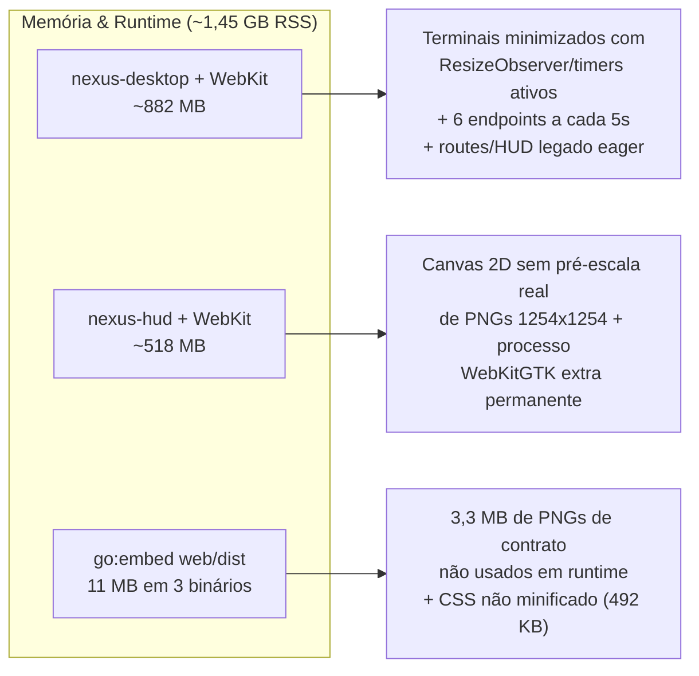

# Plano Completo de Melhorias — Memória, Performance, Visual e Organização do IAPro Nexus

> **Documento autocontido para execução em outro coding harness.**
> Todas as medições, caminhos de arquivo, símbolos e comandos abaixo foram verificados diretamente sobre o repositório `/projetos/nexus` na branch `release/v1.0.0` (commit base `3c896aab`).

---

## 0. Metadados & Contrato de Execução para Outro Harness

- **Repositório:** `/projetos/nexus`
- **Branch única de trabalho:** `release/v1.0.0` (base verificada: `3c896aab`). **Proibido** abrir branches `feat/*`, `fix/*`, `docs/*`, abrir PRs paralelos ou desenvolver em `main` (`AGENTS.md` §9).
- **Documentos obrigatórios antes de editar:**
  - `/projetos/nexus/AGENTS.md`
  - `/projetos/nexus/docs/engineering/WEB_ENGINEERING_STANDARDS.md`
  - `/projetos/nexus/docs/engineering/ENGINEERING_STANDARDS.md`
- **Regras técnicas invioláveis:**
  1. **CSS / Design System (`web/`):** usar SCSS Modules (`*.module.scss`) para componentes, tokens semânticos (`var(--nx-*)`), **zero** `!important` novos, **zero** `style={{ ... }}` estático (inline só para coordenadas/dimensões calculadas em runtime), HTML semântico (`<button type="button">`, `<label>`, etc.) e acessibilidade WCAG 2.2 AA (`:focus-visible`, `aria-label`).
  2. **i18n (`web/src/i18n/locales/`):** zero texto visível hardcoded em JSX/TSX; qualquer nova chave deve ser adicionada com paridade exata em `pt-BR.ts`, `en.ts` e `es.ts` (validado por `web/src/i18n/i18n.test.ts`).
  3. **NEX Identity Lock (`NEX-ID-v1`):** **NUNCA** modificar arquivos fonte sob `web/public/nex/`, hashes em `docs/design/nex/identity-lock.json` nem alterar `status` em `docs/design/nex/RELEASE_READINESS.json` para `READY`. Qualquer mudança em `web/src/nex-v2/motion/nexRigCanvas.ts` ou `web/scripts/build.mjs` exige rodar `verify-nex-visual.mjs`, `verify-nex-identity-lock.mjs` e `verify-nex-release-readiness.mjs`.
  4. **Product Discovery (`web/src/features/work/featureAnnouncements.ts`):** otimizações internas de memória/refatoração/layout de controles já existentes **não** devem criar novos anúncios no catálogo; apenas registre explicitamente no commit e no `DEV/WORKLOG.md` que `featureAnnouncements.ts` permaneceu inalterado. Caso opte por adicionar uma configuração visível nova ao usuário (ex.: seletor de scrollback em Configurações ou toggle de HUD sob demanda), atualizar `featureAnnouncements.ts`, `featureReveal.test.ts`, `tourTargets.test.ts` e `featureAnnouncements.test.ts`.
  5. **Resiliência a JSON Go (`null` arrays):** normalizar arrays vindos da API Go com `asArray()` (`web/src/lib/safeArray.ts`) ou `(val || [])` antes de `.map`/`.length`.
  6. **Go / CLI:** comandos com saída estruturada devem suportar `--json`; manter flags públicas compatíveis; validar com `go vet -tags=gtk3 ./...`, `-race` e `go build ./...`.

---

## 1. Baseline Medido (Antes das Mudanças — `release/v1.0.0` @ `3c896aab`)

### 1.1 Consumo de Memória e Processos no Host Linux

Medição via `ps -eo pid,ppid,rss,vsz,pmem,pcpu,nlwp,comm,args --sort=-rss`:

| Processo / Papel | PID | RSS | Threads (`nlwp`) | Observação |
| --- | ---: | ---: | ---: | --- |
| `nexus-desktop` (Wails/GTK) | `3539960` | ~220 MB | 64 | Binário Desktop principal |
| `WebKitWebProcess` (do Desktop) | `3540075` | ~613 MB | 42 | Renderer único com Workspace, terminais minimizados montados e bundles |
| `WebKitNetworkProcess` (do Desktop) | `3540074` | ~49 MB | 10 | Processo de rede do WebKitGTK |
| **Subtotal Desktop** | — | **~882 MB** | 116 | Maior fatia da UI local |
| `nexus-hud --linked` (Wails/GTK) | `3539007` | ~197 MB | 44 | Segundo app WebKitGTK separado |
| `WebKitWebProcess` (do HUD) | `3539067` | ~272 MB | 40 | Avatar + painel `nex-v2` |
| `WebKitNetworkProcess` (do HUD) | `3539066` | ~49 MB | 10 | Processo de rede do HUD |
| **Subtotal HUD** | — | **~518 MB** | 94 | Roda permanentemente mesmo ocioso/recolhido |
| `nexus web --port=13000 --no-open` | `3538992` | ~50 MB | 28 | Core + API HTTP/WS |
| **Total UI + Core** | — | **~1,45 GB** | 238 | **~1,40 GB** só na camada Desktop + HUD |
| 8× `nexus __control-host --runtime ...` | vários | 21–36 MB/un | 15/un | Supervisors de sessões CLI ativas (`agy`, `codex`) |
| 2× `nexus __browser-mcp-stdio` | vários | ~20 MB/un | 9–11/un | Pontes MCP de browser |
| `[nexus-hud] <defunct>` | `25950` | 0 KB | 1 | Processo zumbi remanescente sem reap |

### 1.2 Artefatos de Build Web e Binários Go

| Artefato | Medição Atual | Origem Identificada |
| --- | ---: | --- |
| `web/dist/` (total) | **11 MB** | Embutido integralmente nos 3 binários Go via `//go:embed all:embedded` (`internal/control/web/dist.go:9`) |
| `web/dist/nex/hybrid-v1/nex_source_original.png` | **1,7 MB** (`1254×1254`) | Asset de referência/verificação — **não usado** em runtime |
| `web/dist/nex/hybrid-v1/reconstructed_idle.png` | **1,6 MB** (`1254×1254`) | Asset de referência/verificação — **não usado** em runtime |
| `web/dist/nex/hybrid-v1/body_base.png` | **1,5 MB** (`1254×1254`) | Textura base carregada e mantida em alta resolução pelo `NexRigCanvas` |
| `web/dist/nex/hud-32bit/nex-idle-atlas-128.png` | **726 KB** (`1024×1536`) | Atlas travado por `NEX-ID-v1` (hash verificado em `build.mjs`) |
| `web/dist/bundle.css` | **492 KB** | Sass compilado em modo expandido + `xterm.css` concatenado sem minificação CSS |
| `web/dist/bundle.js` | **462 KB** | Importação eager de `NexusDemoApp`, `ConversationSpikePage`, `DesktopHudApp` e `NexusHud` (`1.385` linhas) |
| `web/dist/chunks/FlowRunsHistorySurface-*.js` | **262 KB** | Maior chunk de superfície |
| `web/dist/nex-v2.js` / `nex-v2.css` | **237 KB** / **51 KB** | Bundle isolado do NEX 2.0 (`nex-v2.css` concatenado sem minificação) |
| `/home/desenvolvedor/.local/bin/nexus` | **34 MB** | Embute os `11 MB` de `embedded/` |
| `/home/desenvolvedor/.local/bin/nexus-desktop` | **36 MB** | Embute os `11 MB` de `embedded/` |
| `/home/desenvolvedor/.local/bin/nexus-hud` | **36 MB** | Embute os `11 MB` de `embedded/` |

### 1.3 Dívida Visual, CSS e Concentração de Código

- **`<FeatureTour>` sem `compact`:** `14` de `15` usos atuais ainda exibem rótulos completos (`Conhecer esta área` / `Novidades`); apenas `AgentTerminal.tsx:1232` usa `compact={windowChrome}`.
- **`workspace-styles/*.css`:** **8.536 linhas** distribuídas em 17 arquivos.
- **Uso de `!important`:** **148 ocorrências** em `web/src/` (**107** concentradas apenas em `web/src/app/workspace-styles/15-context-and-responsive.css`).
- **Paridade de tokens CSS:** **272 entradas** na ratchet `web/scripts/token-parity-baseline.json`.
- **Maiores arquivos Frontend (`web/src/`, excluindo testes e `locales/`):**
  - `web/src/types.ts` (2.682)
  - `web/src/features/browser/BrowserSurface.tsx` (1.945)
  - `web/src/app/NexusWorkspaceApp.tsx` (1.791)
  - `web/src/nexus/AgentTerminal.tsx` (1.712)
  - `web/src/workspace/WorkspaceRenderer.tsx` (1.584)
  - `web/src/features/hud/NexusHud.tsx` (1.385)
  - `web/src/nexus/api.ts` (1.343)
  - `web/src/features/browser/BrowserSurface.module.scss` (1.242)
  - `web/src/features/settings/SettingsSurface.tsx` (982)
  - `web/src/components/TerminalPane.tsx` (900)
- **Maiores arquivos Backend (`internal/` + `cmd/`, excluindo testes):**
  - `internal/app/app.go` (2.215)
  - `internal/tui/usage_table.go` (1.726)
  - `internal/nexus/runner/runner.go` (1.584)
  - `internal/control/host/host.go` (1.480)
  - `internal/nexus/nexus.go` (1.422)
  - `internal/nexus/mission_executor.go` (1.403)



---

## 2. Estratégia & Ordem de Execução Recomendada

Execute na ordem **Fase 1 -> Fase 2 -> Fase 3 -> Fase 4**, em **commits pequenos, testáveis e reversíveis** direto em `release/v1.0.0`.

> **Defaults seguros para execução autônoma:**
> - Executar **T1.1–T1.6**, **T2.1–T2.3**, **T3.1–T3.3** e **T4.1–T4.2** mantendo 100% de compatibilidade com rotas, contratos CLI/`--json`, `NEX-ID-v1` e comportamento de terminais minimizados (PTY nunca deve ser encerrado ao minimizar).
> - Em decisões opcionais de UI que introduziriam novas preferências visíveis ao usuário (toggle de HUD sob demanda em T1.6 ou seletor de scrollback em T1.5), **preferir primeiro os ganhos internos invisíveis** (pré-escala, build slim, lazy routes, polling em camadas, pausa de reflow minimizado, `Wait()` em processos); caso implemente o controle visível em Configurações, cumprir a regra de Product Discovery (`featureAnnouncements.ts` + testes).

---

## 3. Fase 1 — Memória, Performance de Runtime e Tamanho de Bundles (P0)

### T1.1 — Pré-escala real de texturas em `NexRigCanvas`

- **Arquivos:**
  - `web/src/nex-v2/motion/nexRigCanvas.ts` (`L50–L355`)
  - `web/src/nex-v2/motion/` (adicionar teste unitário para pré-escala/limpeza se aplicável ao ambiente Node/jsdom)
- **Problema atual:**
  - O comentário em `nexRigCanvas.ts:53-54` afirma *"Pre-scales decoded textures to the active viewport scale so idle ticks do not resample 1254x1254 bitmaps every frame"*, mas `load()` (`L107-L118`) e `render()` (`L222`, `L303`, `L312`) desenham diretamente dos `HTMLImageElement` originais (`body_base.png` `1254×1254` + 8 recortes `eye_*`, `fin_*`, `module_*`). Isso força o WebKitGTK a reter superfícies decodificadas de alta resolução e fazer downscale repetido a cada tick.
- **Implementação:**
  1. Ao finalizar `Promise.all` em `load()`, calcular a escala necessária a partir de `backingSizePx` atual (com margem de segurança `1.25×` para comportar `pose.breathing` e zoom sem pixelização, limitado a `ART_CANVAS_SIZE`).
  2. Criar helper `prescaleLayer(source: HTMLImageElement, targetWidth: number, targetHeight: number): HTMLCanvasElement` usando `<canvas>` 2D offscreen (`imageSmoothingEnabled = true`, `imageSmoothingQuality = 'high'`), proporcional às dimensões reais da camada (`Math.max(1, Math.ceil(sourceW * ratio))`).
  3. Armazenar os canvases pré-escalados em `baseSurface` e `layerSurfaces`, e **limpar** referências aos `HTMLImageElement` originais (`entries` locais deixam de ficar retidos em `this.baseImage` / `this.layerImages`), exceto se optar por re-gerar via `load()` caso `resize()` aumente `backingSizePx` acima da margem `1.25×`. Para tamanhos fixos do HUD (`128–256px` CSS, `<= 512px` físico em DPR 2), manter teto de bake em `512px` evita re-download na maioria absoluta dos casos.
  4. **Preservar geometria exata:** `render()` continua aplicando `setTransform(scale, 0, 0, scale, offsetX * scale, offsetY * scale)` no sistema lógico `ART_CANVAS_SIZE` (`1254`). Ao chamar `ctx.drawImage(surface, dx, dy, layer.width, layer.height)` (ou `drawImage(this.baseSurface, 0, 0, ART_CANVAS_SIZE, ART_CANVAS_SIZE)`), o `<canvas>` já pré-escalado estica/mapeia para o bloco lógico usando uma fração da memória original.
  5. Em `destroy()`, zerar explicitamente `canvas.width = 0; canvas.height = 0` de `baseSurface` e `layerSurfaces` para liberar backing stores no WebKitGTK imediatamente.
- **Armadilha / Risco:**
  - Garantir compatibilidade quando `document.createElement('canvas').getContext('2d')` retorna `null` em testes Node/SSR: fazer fallback seguro retornando a própria `HTMLImageElement`.
  - Nunca alterar `web/public/nex/hybrid-v1/*.png`.
- **Verificação:**
  - `node scripts/verify-nex-visual.mjs && node scripts/verify-nex-identity-lock.mjs && node scripts/verify-nex-release-readiness.mjs`
  - Inspeção visual no `nexus-hud` com DPR 1x/2x verificando nitidez dos olhos, aletas e módulos orbitais.

---

### T1.2 — Filtrar ativos não-runtime e minificar CSS em `web/scripts/build.mjs`

- **Arquivo:** `web/scripts/build.mjs`
- **Problema atual:**
  - `cp(publicDir, distDir, { recursive: true })` copia tudo de `web/public/`, levando `nex/hybrid-v1/nex_source_original.png` (`1,7 MB`), `nex/hybrid-v1/reconstructed_idle.png` (`1,6 MB`) e `nex/nex-site-hero.svg` para `web/dist/` e depois para `internal/control/web/embedded/`, inflando os 3 binários Go.
  - `createSassPlugin` usa `sass.compile(args.path)` no estilo default (`expanded`), e depois `nex-v2.css` + `xterm.css` são concatenados sem minificação, deixando `bundle.css` em `492 KB`.
- **Implementação:**
  1. Importar `transform` de `'esbuild'` (`import { build, transform } from 'esbuild';`).
  2. Em `createSassPlugin`: passar `{ style: 'compressed' }` para `sass.compile(args.path, { style: 'compressed' })`.
  3. Ao montar `nex-v2.css` e `bundle.css` (incluindo `xtermCss`), minificar a concatenação com `await transform(cssSource, { loader: 'css', minify: true })`, preservando a ordem exata das regras.
  4. Definir uma allowlist/denylist explícita na cópia `publicDir -> distDir`:
     ```js
     const NON_RUNTIME_PUBLIC_PATHS = new Set([
       'nex/hybrid-v1/nex_source_original.png',
       'nex/hybrid-v1/reconstructed_idle.png',
       'nex/nex-site-hero.svg',
     ]);
     ```
     Usar `filter` no `cp(publicDir, distDir, { recursive: true, filter: ... })` normalizando o caminho relativo (`relative(publicDir, src).replaceAll('\\', '/')`) para pular exatamente esses arquivos de referência/contrato.
  5. **Auditoria adicional segura:** verificar referências a `logo.png` / `nexus-logo.png` / `nexus-logo-dark.png` e `nexus-icon*.png` em `web/index.html`, `web/public/manifest*` e `web/src/` antes de remover qualquer outro asset de `dist/` (só remover duplicata comprovadamente não referenciada).
  6. Manter intactos `nex/hud-32bit/nex-idle-atlas-128.png` e sua checagem SHA-256 (`8256a302fff77996e3563ef42d1e62685b59084c8a17446bb2acb2219e85dfda`) no `dist/`.
- **Critério de aceitação:**
  - `web/dist` reduz de **11 MB** para `<= 8 MB`.
  - `web/dist/bundle.css` cai de **492 KB** em pelo menos 30–40%.
  - Nenhum arquivo sob `web/public/nex/` é modificado (`git status` limpo lá) e todos os scripts `verify-nex-*.mjs` passam.

---

### T1.3 — Code-splitting real no boot (`App.tsx` e `NexusWorkspaceApp.tsx`)

- **Arquivos:**
  - `web/src/App.tsx` (`L1–L82`)
  - `web/src/app/DesktopHudApp.tsx` (`L16–L19`)
  - `web/src/app/NexusWorkspaceApp.tsx` (`L34` e JSX de renderização de `<NexusHud />`)
- **Problema atual:**
  - `App.tsx:4-7` importa sincronamente `NexusDemoApp`, `ConversationSpikePage` e `DesktopHudApp` (que por sua vez importa `NexusHud` de 1.385 linhas).
  - `NexusWorkspaceApp.tsx:34` importa sincronamente `NexusHud`, aumentando `bundle.js` (`462 KB`) e o parse JS na abertura do `nexus-desktop`.
- **Implementação:**
  1. Extrair `isDesktopHudApp()` para `web/src/app/desktopHudDetect.ts` (módulo folha sem dependências de UI) ou inline em `App.tsx`, mantendo re-export em `DesktopHudApp.tsx` se houver testes importando de lá (verificar via `rg -n "isDesktopHudApp" web/src/`). **Não** deixar `App.tsx` importar de `./app/DesktopHudApp`, senão o bundler inclui `NexusHud` no chunk principal.
  2. Converter `NexusDemoApp`, `ConversationSpikePage` e `DesktopHudApp` em `App.tsx` para `React.lazy(() => import(...).then((m) => ({ default: m.X })))` embrulhados em `<React.Suspense fallback={<SurfaceLoadingFallback />}>` (reutilizando `web/src/app/SurfaceLoadingFallback.tsx` já existente!).
  3. Em `NexusWorkspaceApp.tsx`, transformar `NexusHud` em `React.lazy` com `<Suspense fallback={null}>` (ou somente montá-lo quando `!isDesktopApp()` / fallback legado habilitado — verificar condição exata no arquivo antes de alterar!).
- **Verificação:** `npm --prefix web run typecheck && npm --prefix web run test && npm --prefix web run build` + inspecionar `web/dist/bundle.js` e `web/dist/chunks/` confirmando chunks separados e redução de `bundle.js`.

---

### T1.4 — Polling em camadas e redução de alocação em `useNexusData.ts`

- **Arquivos:**
  - `web/src/app/useNexusData.ts` (`L1–L198`)
  - `web/src/app/useNexusData.test.ts` (novo teste cobrindo cadências rápida/lenta e `document.hidden`)
- **Problema atual:**
  - A cada `5000ms` (quando a aba está visível), `refreshGlobal()` (`L76-L137`) dispara simultaneamente `Promise.all` com **6 chamadas** (`listProjects`, `getWorkspaces`, `getRuntimes`, `getProviders`, `getProfiles`, `getEvents`), mesmo `projects`/`workspaces`/`providers`/`profiles` raramente mudando sem ação do usuário.
- **Implementação:**
  1. Quebrar em dois fetchers internos deduplicados (`fastInFlightRef`, `metadataInFlightRef`):
     - `refreshFast()` (a cada `5000ms` quando `!document.hidden`): chama `api.getRuntimes()` e `api.getEvents()`, mantendo `sameRuntimeSnapshot` e `sameIdList` (ou comparação incluindo `timestamp`/`id` para eventos).
     - `refreshMetadata()` (no mount + a cada `30000ms` quando `!document.hidden`): chama `nexus.listProjects()`, `api.getWorkspaces()`, `api.getProviders()`, `api.getProfiles()`.
  2. Manter `refreshGlobal()` público retornando `{ runtimes }` e executando `refreshFast()` + `refreshMetadata()` em paralelo para que todos os chamadores atuais (criar/remover projeto, autenticar conta, recarregar tudo) continuem atualizando estado imediatamente sem alterar assinaturas externas.
- **Critério de aceitação:** Redução de ~66% das requisições de polling recorrente em regime estável; `useNexusData.test.ts` validando intervalos `5s` vs `30s` e pausa em `document.hidden === true`.

---

### T1.5 — Janelas minimizadas sem thrash de `ResizeObserver`/timers + memoização em `WorkspaceRenderer`

- **Arquivos:**
  - `web/src/workspace/WorkspaceRenderer.tsx` (`L1207–L1275` e renderização do corpo da janela)
  - `web/src/app/WorkspaceSurfaceHost.tsx`
  - `web/src/nexus/AgentTerminal.tsx` (`L277`, lógica de `ResizeObserver` / `fit()` e props)
  - `web/src/nexus/terminalSettings.ts` (`L1–L87`)
- **Contrato obrigatório a preservar:**
  - Como documentado em `WorkspaceRenderer.tsx:1209-1212`, janelas minimizadas **não** podem desmontar o `AgentTerminal` nem desconectar o WebSocket/PTY; devem continuar ocultas (`hidden` / `inert`) com estado e buffer preservados.
- **Implementação:**
  1. Propagar `paused={minimized}` (ou `surfaceHidden={minimized}`) do `WorkspaceRenderer` -> `WorkspaceSurfaceHost` -> `AgentTerminal`.
  2. Em `AgentTerminal.tsx`:
     - Quando `surfaceHidden` for `true`, desconectar/ignorar callbacks do `ResizeObserver` / `scheduleFit()`, pausar o intervalo visual `setConnectingForMs` (`L277`) e não forçar re-fits enquanto oculto.
     - Quando `surfaceHidden` transicionar de `true -> false`, disparar um `requestAnimationFrame(() => scheduleFit())` e restaurar scroll se `followsOutput` estiver ativo.
     - Opcionalmente, estudar `clear()` / limite de buffers temporários internos que não afetam o scrollback principal do xterm.
  3. Extrair o card/conteúdo interno da janela em `WorkspaceRenderer.tsx` para componente memoizado com `React.memo` e comparador raso de props relevantes, impedindo re-render de todos os terminais abertos quando apenas `zIndex` de outra janela ou estado não relacionado muda.
  4. *(Opcional — só se o usuário optar ou se mantiver default 5000)*: em `terminalSettings.ts`, manter `DEFAULT_TERMINAL_SCROLLBACK = 5000` (há testes explícitos em `terminalUsability.test.ts:168` e `terminalSettings.test.ts:74` verificando `5000` como padrão seguro), mas permitir override explícito via `getStoredTerminalScrollback()` caso se deseje perfil econômico configurável sem quebrar os defaults esperados pelos testes.

---

### T1.6 — Higiene de processos filhos em Go & opção para reduzir os ~518 MB do HUD

- **Arquivos:**
  - `internal/desktop/app.go` (`L308`)
  - `internal/hudlink/hudlink.go`
  - Opcional: configuração Desktop/Settings para HUD sob demanda
- **Implementação:**
  1. Em `internal/desktop/app.go:308`, `OpenExternal` atualmente chama `return exec.Command(cmd, args...).Start()` no `darwin` (e fallback) sem aguardar o processo terminar, deixando filhos `<defunct>` se o comando retornar antes do pai. Substituir por:
     ```go
     proc := exec.Command(cmd, args...)
     if err := proc.Start(); err != nil {
         return err
     }
     go func() { _ = proc.Wait() }()
     return nil
     ```
  2. Auditar todo `internal/` por `\.Start\(` garantindo que cada `exec.Cmd.Start()` tenha `Wait()` em goroutine ou `Process.Release()` justificado (anotar resultado da auditoria no WORKLOG).
  3. **Sobre os ~518 MB RSS do `nexus-hud`:**
     - Em `cmd/nexus-hud/nex_v2.go`, validar se quando `ShowAvatar == false` e painel fechado há timers ou WebViews ativos desnecessariamente (`NexPresenceApp.tsx:184` já checa `document.visibilityState !== 'visible'` e `presence.paused`).
     - Como melhoria opcional (se o usuário desejar modo econômico para economizar ~518 MB sem matar funcionalidade quando necessário): adicionar toggle em Configurações Desktop ("Iniciar HUD flutuante automaticamente com o Desktop", default `true` mantendo compatibilidade, persistido em config local e lido por `hudlink.Spawn()`). Caso implemente esse toggle na UI, lembre de registrar em `featureAnnouncements.ts`.

---

## 4. Fase 2 — Visual, Ergonomia e Limpeza de Chrome/CSS (P1)

### T2.1 — Compactar `WorkspaceTaskbar` e eliminar tooltips hardcoded

- **Arquivos:**
  - `web/src/workspace/WorkspaceTaskbar.tsx` (`L133`, `L165`, `L172`, `L185`)
  - `web/src/i18n/locales/{pt-BR,en,es}.ts`
- **Implementação:**
  1. Na linha `185` de `WorkspaceTaskbar.tsx`, passar `compact`:
     ```tsx
     {project?.id && <FeatureTour projectId={project.id} surface="workspace" compact />}
     ```
  2. Substituir os 3 textos hardcoded restantes no JSX (`L133`, `L165`, `L172`) por chaves i18n em `statusBar.*`:
     - `statusBar.focusAttentionTooltip`
     - `statusBar.coreRuntimeTooltip`
     - `statusBar.intelligenceActiveTooltip` (com interpolação `{{provider}}`)
  3. Adicionar as 3 chaves em `pt-BR.ts`, `en.ts` e `es.ts`.

---

### T2.2 — Padronizar `<FeatureTour compact />` em superfícies densas

- **Arquivos candidatos (inspecionar cabeçalho de cada um antes de aplicar):**
  - `web/src/notifications/InAppNotificationCenter.tsx` (`L475`)
  - `web/src/features/browser/BrowserSurface.tsx` (`L1213`)
  - `web/src/features/work/DirectSessionLauncher.tsx` (`L260`)
  - `web/src/features/agents/AgentsSurface.tsx` (`L847`)
  - `web/src/features/usage/UsageSurface.tsx` (`L516`)
  - `web/src/features/work/FlowRunSurface.tsx` (`L302`)
  - `web/src/features/work/FlowRunsHistorySurface.tsx` (`L314`)
- **Critério de decisão por tela:** aplicar `compact` sempre que o `<FeatureTour>` dividir uma toolbar/header horizontal com filtros, abas, botões de ação primária ou URL bar, liberando área útil sem ocultar a descoberta de funcionalidades (`aria-label` e `<Tooltip>` já existem no modo `compact` implementado em `FeatureTour.tsx`).
- **Regra obrigatória:** nunca remover `data-tour` nem `data-feature-tour-scope`. Rodar `tourTargets.test.ts`, `featureReveal.test.ts`, `featureTour.test.ts` e `FeatureTour.test.tsx`.

---

### T2.3 — Eliminar os 107 `!important` de `15-context-and-responsive.css` e reduzir `token-parity-baseline.json`

- **Arquivos:**
  - `web/src/app/workspace-styles/15-context-and-responsive.css` (`L1–L391`)
  - Arquivos CSS/SCSS tocados + `web/scripts/token-parity-baseline.json`
- **Implementação:**
  1. Mapear os seletores base em `07-topbar-and-dialogs.css` / `12-zen-and-flow.css` que hoje competem com as `@media` / `@container` queries de `15-context-and-responsive.css`.
  2. Como `15-context-and-responsive.css` é importado depois na cascata, aumentar levemente a especificidade dos seletores responsivos quando necessário (ex.: `.nx-topbar .nx-topbar__project-btn`, `.nx-composer-flow-body.nx-composer-flow-body`) e remover todos os `!important` desse arquivo, reduzindo de **148** para **<= 41** ocorrências globais.
  3. Validar layout nos breakpoints definidos no arquivo (`1440px`, `1320px`, `1120px`, `820px`, `768px`, `600px`, `480px`, `360px`) e rodar `remoteAccessMobile.style.test.ts` e `workspaceSurfaceStyles.test.ts`.
  4. Nos arquivos CSS/SCSS alterados (começando pelos top ofensores da baseline `token-parity-baseline.json`), trocar literais de tamanho de fonte e espaçamento pelos tokens canônicos de `web/src/styles/_typography.scss` e `01-foundation.css`:
     - `0.714rem` -> `var(--nx-font-size-caption)`
     - `0.786rem` -> `var(--nx-font-size-2xs)`
     - `0.857rem` -> `var(--nx-font-size-xs)`
     - `0.929rem` -> `var(--nx-font-size-sm)`
     Depois rodar `node web/scripts/check-token-parity.mjs --update-baseline` e conferir no `git diff web/scripts/token-parity-baseline.json` que **nenhuma** entrada subiu — apenas diminuíram ou foram removidas.

---

## 5. Fase 3 — Organização de Código e Decomposição de Monólitos (P2)

### T3.1 — Fatiar `web/src/types.ts` (2.682 linhas) por domínio

- **Arquivos:**
  - `[NEW]` `web/src/types/projects.ts`, `agents.ts`, `missions.ts`, `usage.ts`, `browser.ts`, `system.ts`, `index.ts`
  - `[MODIFY]` `web/src/types.ts` (passa a ser barrel `export * from './types/index';`)
- **Vantagem:** zero alteração exigida nos dezenas de imports `from '../types'` existentes, mas edição e revisão futura passam a ocorrer em módulos pequenos por domínio (`<= 400` linhas cada).

---

### T3.2 — Decompor `AgentTerminal.tsx` (1.712 linhas) e `NexusWorkspaceApp.tsx` (1.791 linhas)

- **Para `AgentTerminal.tsx`:**
  - Extrair `web/src/nexus/useTerminalConnection.ts` (ciclo WebSocket/PTY, reconexão, `CONTROL`/`VIEW_ONLY`, heartbeat).
  - Extrair `web/src/nexus/AgentTerminalToolbar.tsx` (`windowChrome` toolbar, `modeButtons`, `zoomGroup`, `follow`, `FeatureTour`, botão skills/instrução).
  - Extrair `web/src/nexus/AgentTerminalOverlays.tsx` (`RecoverOverlay`, `DisconnectOverlay`, feedback de status e `scrollToBottomBtn`).
- **Para `NexusWorkspaceApp.tsx`:**
  - Extrair `web/src/app/useAttentionNavigation.ts` (radar de atenção + notificações push + título dinâmico).
  - Extrair `web/src/app/useDesktopCommands.ts` (`subscribeDesktopCommand` + atalhos globais).
  - Extrair `web/src/app/useProjectRouteSync.ts` (resolução de projeto na URL e fallback para rota válida).
- **Para `BrowserSurface.tsx` (1.945 linhas) — se houver tempo no ciclo:**
  - Separar painel de inspector/visual diff (`VisualDiffPanel` já é separado, isolar barra de navegação/sessão em subcomponente).
- **Heurística `AGENTS.md`:** cada novo arquivo <= 300 linhas, 1 componente conceitual por arquivo, `*.module.scss` colocated.

---

### T3.3 — Decompor hotspots Go (`internal/app/app.go` e `internal/control/host/host.go`)

- **Para `internal/app/app.go` (2.215 linhas):**
  - Quebrar em arquivos no mesmo pacote `app` por subcomando (`cmd_web.go`, `cmd_agent.go`, `cmd_project.go`, `cmd_usage.go`, `cmd_doctor.go`), mantendo `app.go` apenas com o roteador principal (`Run`) e helpers compartilhados.
- **Para `internal/control/host/host.go` (1.480 linhas):**
  - Extrair `ring_buffer.go` (isolando `RingBuffer`), `pty_stream.go` (leitura/broadcast do PTY e detecção de atenção) e `control_rpc.go` (endpoints/protocolo do host).
- **Regra:** zero mudança de interface pública, flags CLI ou JSON `--json`.

---

## 6. Fase 4 — Guardrails Contínuos (P3)

### T4.1 — Budget de tamanho em `web/scripts/build.mjs`

- Ao término do build em `web/scripts/build.mjs`, calcular tamanho total de `web/dist/`, `bundle.js`, `bundle.css`, `nex-v2.js` e imprimir tabela resumo.
- Suportar flag `--check-budget` (e/ou check default após Fase 1): falhar o build se `web/dist` > `8.5 MB`, `bundle.css` > `320 KB` ou `bundle.js` > `420 KB` (ajustar os tetos aos números reais medidos logo após completar T1.2 e T1.3, deixando margem de ~10–15% para crescimento saudável).

### T4.2 — Diagnóstico de processos e RSS no `nexus doctor --json`

- Inspecionar implementação atual de `doctor` em `internal/app/` (provavelmente em `app.go` ou arquivo dedicado).
- Adicionar seção opcional `processes` no output estruturado de `nexus doctor --json` reportando processos locais `nexus`, `nexus-desktop`, `nexus-hud`, `__control-host`, `WebKitWebProcess` filhos, seus RSS e contagem de eventuais `<defunct>` (leitura não-destrutiva via `/proc` no Linux, fallback gracioso em macOS/Windows), facilitando futuras auditorias de memória em 1 comando.

---

## 7. Protocolo Completo de Verificação (Gate Obrigatório)

Antes de concluir qualquer entrega e antes de declarar sucesso:

```bash
# 1. Frontend completo (format, lint ESLint, Stylelint, arquitetura/paridade de tokens, TS, Vitest, build)
npm --prefix web run format:check \
  && npm --prefix web run lint \
  && npm --prefix web run lint:styles \
  && npm --prefix web run check:styles \
  && npm --prefix web run typecheck \
  && npm --prefix web run test \
  && npm --prefix web run build

# 2. Contratos visuais e lock do NEX (obrigatório ao tocar nexRigCanvas.ts ou build.mjs)
node scripts/verify-nex-visual.mjs \
  && node scripts/verify-nex-identity-lock.mjs \
  && node scripts/verify-nex-release-readiness.mjs

# 3. Backend Go & higienização Git
gofmt -l cmd/ internal/ \
  && NEXUS_REAL_HOME="" GOCACHE=/tmp/nexus-gocache-clean GOFLAGS=-buildvcs=false go vet -tags=gtk3 ./... \
  && NEXUS_REAL_HOME="" GOCACHE=/tmp/nexus-gocache-clean GOFLAGS=-buildvcs=false go test -tags=gtk3 -race ./internal/desktop/... ./internal/hudlink/... ./internal/control/web/... ./internal/app/... ./internal/control/host/... \
  && NEXUS_REAL_HOME="" GOCACHE=/tmp/nexus-gocache-clean GOFLAGS=-buildvcs=false go build ./... \
  && git diff --check
```

### Medição Antes vs Depois (registrar números reais no `DEV/WORKLOG.md`)

```bash
# Tamanhos pós-build e instalação
du -sh web/dist internal/control/web/embedded
ls -lh web/dist/bundle.js web/dist/bundle.css web/dist/nex-v2.js web/dist/nex-v2.css
ls -lh /home/desenvolvedor/.local/bin/nexus /home/desenvolvedor/.local/bin/nexus-desktop /home/desenvolvedor/.local/bin/nexus-hud

# Contadores CSS/Código
rg -c '!important' web/src/ | awk -F: '{s+=$2} END{print "important_total=" s+0}'
rg -c '": ' web/scripts/token-parity-baseline.json

# RSS dos processos vivos após reiniciar Desktop + HUD + Core
ps -eo pid,ppid,rss,nlwp,comm,args --sort=-rss | grep -E 'nexus|WebKit|PID' | grep -v grep
```

### Instalação Local & Reinício Limpo no Host Linux (Armadilhas Conhecidas)

1. **Armadilha de `PATH` / shim `xdg-open`:** nunca iniciar `nexus web` ou `nexus-desktop` herdando `/home/desenvolvedor/.local/share/ai-manager/runtime/bin` antes de `/usr/bin`, pois o shim intercepta chamadas e pode prender a instância única D-Bus `com.iapro.nexus.desktop`. Sempre limpar `AI_PROFILE`, `AI_PROVIDER`, `NEXUS_CONFIG_DIR`, `NEXUS_DATA_DIR` e fixar `HOME=/home/desenvolvedor`, `NEXUS_REAL_HOME=/home/desenvolvedor`, `XDG_*` e `PATH="/home/desenvolvedor/.local/bin:/usr/local/bin:/usr/bin:/bin:..."`.
2. **Armadilha de `pkill -f`:** nunca usar `pkill -f nexus` direto dentro do subshell de comando (pode matar o próprio comando). Sempre iterar `pgrep -f` pulando `"$$"`:
   ```bash
   for p in $(pgrep -f '/home/desenvolvedor/.local/bin/nexus( web|-desktop|-hud)'); do
     [ "$p" != "$$" ] && kill "$p" 2>/dev/null || true
   done
   ```
3. Instalar via:
   ```bash
   NEXUS_REAL_HOME="" GOCACHE=/tmp/nexus-gocache-clean make install-local
   ```
   e subir `nexus web --port=13000 --no-open` em background seguido de `nexus-desktop` (que sobe o `nexus-hud --linked`) usando o ambiente limpo do usuário.

---

## 8. Critérios de Parada / Escalação

O harness executor **deve parar e consultar o usuário** se ocorrer qualquer um dos cenários abaixo:
1. Qualquer falha ou divergência de SHA-256 em `verify-nex-identity-lock.mjs` ou degradação perceptual na renderização do `NexRigCanvas` em 1x/2x DPI.
2. Quebra de testes de responsividade (`remoteAccessMobile.style.test.ts` ou `workspaceSurfaceStyles.test.ts`) ou regressão visual em algum breakpoint ao remover `!important` em `15-context-and-responsive.css` que exija decisão de design.
3. Inclusão de qualquer controle visível novo (ex.: opção de HUD sob demanda ou seletor de scrollback em Configurações) caso o texto/posicionamento em `featureAnnouncements.ts` precise de revisão de produto.
4. Qualquer conflito ou mudança de contrato `--json` na CLI ou em `AgentTerminal` ao fatiar os monólitos.
