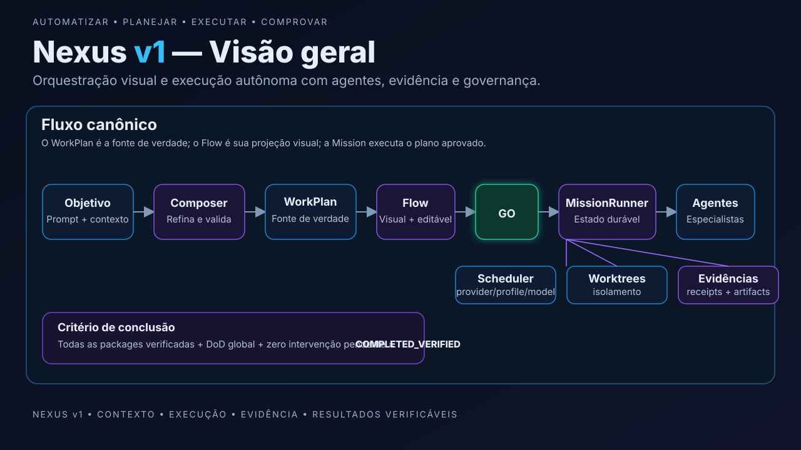
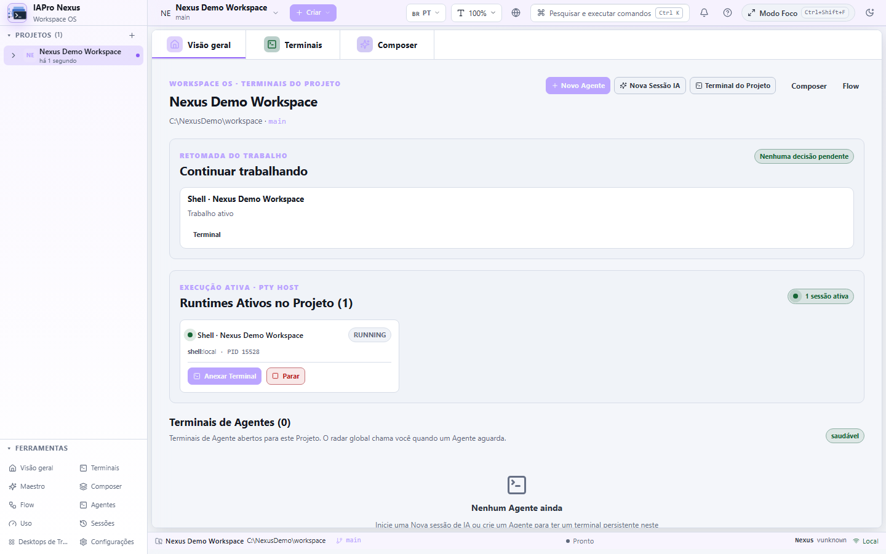
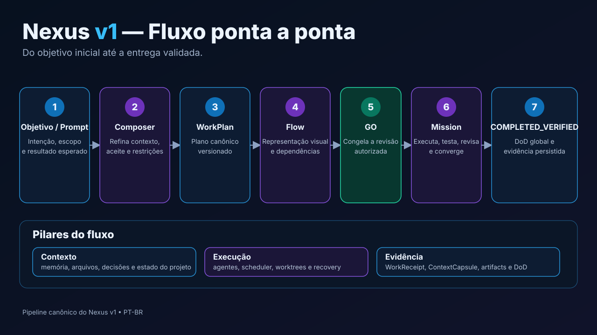
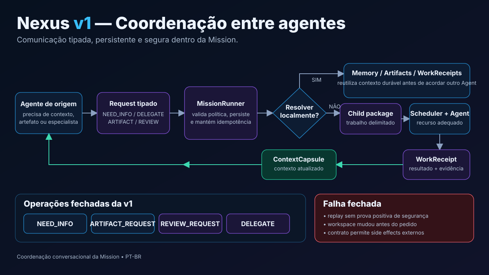

<p align="center">
  
</p>

<h1 align="center">IAPro Nexus</h1>

<p align="center"><strong>Uma workstation local e um control plane para coding agents.</strong></p>

<p align="center">
Transforme objetivos em trabalho executável, coordene Agents persistentes, escolha recursos de IA,
execute com isolamento e só conclua quando houver evidência verificável.
</p>

<p align="center">
  <a href="docs/TLDR.md">TL;DR</a> ·
  <a href="docs/quick-start.md">Quick Start</a> ·
  <a href="docs/product/how-it-works.md">Como funciona</a> ·
  <a href="docs/README.md">Documentação</a> ·
  <a href="README.en.md">English</a> ·
  <a href="README.es.md">Español</a>
</p>



> **Estado em 18/10/2026:** o source da branch `release/v1.0.0` declara `1.0.0-beta.10`.
> **A v1 estável não está homologada nem publicada.** Não inferir releases ou instaladores a partir da versão do código.
> Consulte [status da release](docs/release-status.md) e [plataformas](docs/operations/platform-support.md).

## TL;DR

O Nexus reúne em um único Core:

- Projects e workspaces;
- Agents persistentes;
- providers, perfis, modelos e quota;
- terminais e runtimes supervisionados;
- Composer, WorkPlan e Flow;
- Missions duráveis;
- worktrees isolados;
- Scheduler e políticas de recurso;
- memória, receipts, artifacts e evidência;
- recovery, intervenção humana e Definition of Done global.

Para uma tarefa simples, use **Direct**. Para um objetivo complexo, o caminho
canônico é:

```text
Objetivo → Composer → WorkPlan → Flow → GO → MissionRunner → Agents → Evidência → COMPLETED_VERIFIED
```

→ [Entenda o fluxo ponta a ponta](docs/product/how-it-works.md)

## Comece em 5–10 minutos

O caminho recomendado para primeiro uso é **Direct**:

```text
Project → + New → AI Session → Provider → Terminal
```

### Instalação e disponibilidade

O código-fonte está público no GitHub, mas sua exposição histórica e os direitos de terceiros ainda exigem auditoria; **o código público não equivale a instalador certificado**.
Não há neste documento um download de instalador público verificado para a
versão candidata. A distribuição depende de artefatos reais, assinatura e
certificação exact-SHA. Veja [instalação](docs/getting-started/installation.md).

### Compilar do source

Requisitos de desenvolvimento: Go 1.25+, Bun 1.3.9+, Git e Make.

```bash
git clone https://github.com/IAPro-Community/nexus.git
cd nexus
bun install --cwd web --frozen-lockfile
make build
./nexus doctor
./nexus web
```

Depois:

1. adicione um projeto;
2. use **+ New → AI Session**;
3. selecione um provider disponível;
4. trabalhe no terminal.

Composer, Flow, Mission e Maestro **não são pré-requisitos** para esse caminho.

→ [Quick Start completo](docs/quick-start.md)

## Veja o produto

> **Captura histórica:** a imagem foi produzida em fixture sintética de SHA anterior às últimas modificações visuais. Para homologação, siga [recaptura de evidências](docs/operations/visual-evidence.md).



O [tour visual](docs/product/visual-tour.md) contém as principais superfícies
capturadas automaticamente. Screenshots reais e diagramas conceituais têm
classificações diferentes e não substituem certificação de plataforma.

## Como escolher o modo de trabalho

| Situação | Use |
| --- | --- |
| correção pequena, debugging, exploração | **Direct** |
| ideia ainda precisa de clareza | **Composer** |
| quer revisar etapas/dependências | **Flow** |
| trabalho longo, multi-Agent ou com gates | **Mission** |
| quer metodologia, skills e gates externos | **Maestro** opcional |



## O modelo da v1

### Agent ≠ provider

Um **Agent** é uma identidade persistente. Codex, Claude, Gemini, AGY, OpenCode
e outros executores são recursos que podem ser selecionados conforme
capacidade, policy e disponibilidade.

```text
Agent
 ├─ AgentSpec
 ├─ AgentRevision
 └─ RuntimeGeneration
      └─ ProviderSession
```

Isso evita acoplar o papel do trabalhador a um provider específico.

### WorkPlan é a fonte de verdade

Composer transforma intenção em um artefato estruturado. O **WorkPlan** é o
plano semântico/versionado. O **Flow** é a projeção visual e editável desse
mesmo plano.

Não existe um segundo scheduler ou um segundo formato de plano escondido na UI.

### GO é um boundary real

**GO** autoriza uma revisão específica do plano. A partir daí, a Mission executa
essa revisão sob políticas, isolamento, gates e evidência.

### Mission conclui por evidência

O runtime não aceita “done” textual como sucesso. Uma Mission pode exigir:

- testes;
- verificações;
- review independente;
- artifacts;
- critérios de aceite;
- ausência de intervenção pendente;
- Definition of Done global.

O estado final é `COMPLETED_VERIFIED`.

## Coordenação entre Agents

Agents podem solicitar contexto, artifact, revisão ou trabalho auxiliar por um
protocolo fechado:

- `NEED_INFO`;
- `ARTIFACT_REQUEST`;
- `REVIEW_REQUEST`;
- `DELEGATE`.

Toda coordenação passa pelo `MissionRunner`. O Nexus tenta memória/receipts
antes de criar outra execução e bloqueia replay quando não consegue provar
segurança.



→ [Como funciona a coordenação](docs/product/agent-coordination.md)

## Segurança e guardrails

A v1 opera com **fail closed**:

- push/deploy não são permissões implícitas;
- reviewers/investigators são read-only por padrão;
- escrita paralela usa worktrees isolados;
- dispatch externo desconhecido não é repetido cegamente;
- ausência de evidência não vira sucesso;
- retries e no-progress são limitados;
- mudanças materiais podem exigir intervenção humana.

→ [Guardrails](docs/architecture/guardrails.md) ·
[Segurança](docs/security.pt-BR.md)

## Nexus e Maestro

```text
Nexus   → execução, Agents, runtimes, providers, workspaces, UX e evidência
Maestro → metodologia, skills, risco, gates e políticas de verificação
```

O [Orquestrador Maestro](https://github.com/IAPro-Community/Orquestrador-Maestro)
é opcional. Sem ele, Direct, Agents, Composer, Flow e Mission continuam sendo
capacidades do Nexus.

## Nexus HUD

> **Introduzido na linha beta.7 e integrado ao source beta.10.** O HUD não é
> anunciado como feature multiplataforma certificada sem evidência nativa do SHA de publicação.

**Seu Nexus, sempre visível.** O Nexus HUD projeta o estado operacional já
mantido pelo Core — Capacity Monitor, ResourceScheduler, Cost Intelligence,
Agents e Missions — em duas superfícies:

- **Web HUD:** barra/widget persistente no Nexus Web OS, com adaptação mobile;
- **Desktop HUD:** gadget nativo Wails independente da janela principal.

O HUD é uma projeção, não um segundo monitor. Ele não executa provider probes,
não recalcula routing no frontend, não estima custo sem evidência e não usa LLM.

```text
Capacity + Scheduler + Cost + Agents + Missions
                    ↓
              HUD Projection
               ↙          ↘
        Desktop HUD      Web HUD
```

Rollout inicial: feature flag `hud`, desligada por padrão. Consulte
[produto e limitações](docs/product/hud.md).
## Superfícies

| Superfície | Uso principal |
| --- | --- |
| **Web** | operação visual local, Projects, Agents, Composer, Flow e Missions |
| **Desktop** | shell nativo quando a plataforma possui evidência correspondente |
| **CLI** | automação, diagnóstico, scripting, execução headless e terminal |

O candidato v1 integra Linux amd64, Windows amd64 e macOS arm64. O suporte
público de cada target permanece UNVERIFIED até a certificação nativa
correspondente. Veja [Suporte de plataformas](docs/operations/platform-support.md).

## Documentação

| Quero… | Documento |
| --- | --- |
| usar agora | [Quick Start](docs/quick-start.md) |
| entender o produto inteiro | [Como funciona](docs/product/how-it-works.md) |
| ver interfaces reais | [Tour visual](docs/product/visual-tour.md) |
| entender Composer | [Composer](docs/product/composer.md) |
| entender Flow | [Flow](docs/product/flow.md) |
| entender Missions | [Missions](docs/product/missions.md) |
| entender Agents | [Agents](docs/product/agents.md) |
| entender coordenação dinâmica | [Coordenação entre Agents](docs/product/agent-coordination.md) |
| entender arquitetura | [Arquitetura](ARCHITECTURE.md) |
| operar/diagnosticar | [Operação](docs/operations/README.md) |
| consultar CLI | [CLI](docs/cli/README.md) |
| verificar funcionalidades | [Matriz](docs/reference/feature-matrix.md) |
| contribuir | [CONTRIBUTING](CONTRIBUTING.md) |

A entrada canônica é [docs/README.md](docs/README.md).

## Honestidade operacional

O Nexus diferencia estados como `LIVE`, `CACHED`, `ESTIMATED`,
`UNKNOWN`, `VERIFIED` e `UNVERIFIED`. Documentação, UI e release gates não
devem transformar ausência de evidência em um resultado positivo.

Capturas reais do produto ficam em `docs/assets/screenshots/` com manifesto.
Diagramas conceituais ficam em `docs/assets/diagrams/`.

## Status de release

A documentação de produto descreve **como o source candidato funciona**. A
autorização para uma release estável exige certificação separada do mesmo SHA,
incluindo plataformas nativas e demais gates definidos no programa de fechamento.

→ [Status autoritativo](docs/release-status.md)

## Licença e contribuições

O IAPro Nexus está preparado para publicação **source-available** sob a
[PolyForm Strict License 1.0.0](LICENSE). A licença permite usos não comerciais
nos fins descritos no texto oficial, mas **não autoriza modificar, redistribuir
ou comercializar o código**. Não é software open source pela definição da OSI.

Leia o [guia de licenciamento](docs/legal/LICENSING.md), o
[TL;DR](docs/TLDR.md), os [avisos de terceiros](docs/legal/THIRD_PARTY_NOTICES.md)
e o [CONTRIBUTING](CONTRIBUTING.md). O repositório de source já está público; a auditoria de histórico e a liberação
de binários/versão estável continuam sujeitas ao
[checklist de publicação](docs/PUBLICATION_CHECKLIST.md).
