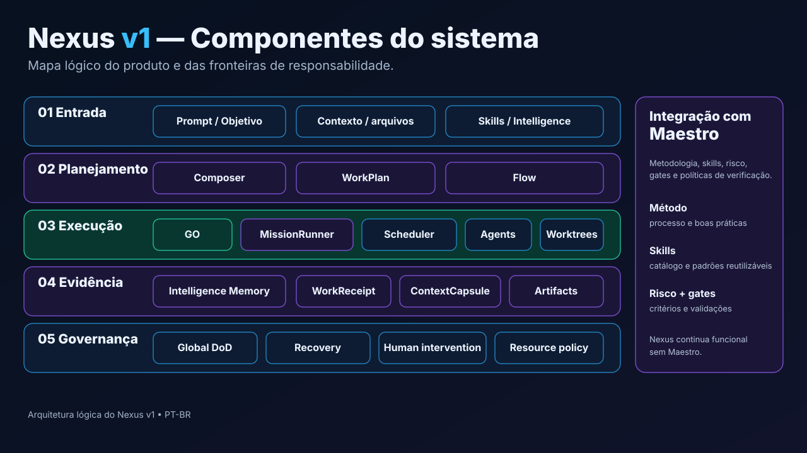

# Documentação do IAPro Nexus v1

Esta é a **entrada pública canônica** para entender, instalar, usar, operar e
estender o Nexus.



> `README.md` apresenta o produto. Esta pasta explica seu uso e arquitetura.
> `DEV/` é um ledger de engenharia, validação e histórico; não deve ser usado
> como onboarding nem substituir a verdade de produto documentada aqui.

## Comece pelo que você quer fazer

| Quero… | Comece em |
| --- | --- |
| visão de 30 segundos e comandos | [TL;DR](TLDR.md) |
| entender restrições da licença | [Licenciamento](legal/LICENSING.md) |
| testar em 5–10 minutos | [Quick Start](quick-start.md) |
| entender o produto inteiro | [Como o Nexus funciona](product/how-it-works.md) |
| verificar 36 recursos com código/testes | [Matriz de funcionalidades](reference/feature-matrix.md) |
| abrir uma sessão agora | [Direct](product/direct.md) |
| transformar uma ideia em plano | [Composer](product/composer.md) |
| revisar dependências e execução | [Flow](product/flow.md) |
| executar trabalho longo/multi-Agent | [Missions](product/missions.md) |
| entender comunicação entre Agents | [Coordenação entre Agents](product/agent-coordination.md) |
| explorar Composer e Flow dentro do app | [Tours guiados interativos](product/composer-flow-tour.md) |
| descobrir novidades e aprender novos recursos | [Novidades e ajuda contextual](product/feature-discovery.md) |
| ver telas reais | [Tour visual](product/visual-tour.md) |
| consultar identidade, desenhos e referências do mascote NEX | [NEX — direção oficial](design/NEX_32BIT_VISUAL_CONTRACT.md) |
| instalar | [Getting Started](getting-started/README.md) |
| operar/diagnosticar | [Operação](operations/README.md) |
| usar a CLI | [Referência da CLI](cli/README.md) |
| desenvolver provider | [Provider development](provider-development.md) |
| entender a arquitetura | [Arquitetura](architecture/overview.md) |
| contribuir | [CONTRIBUTING](../CONTRIBUTING.md) |
| acompanhar metas e priorização do produto | [Plano de adoção e execução 2026](strategy/NEXUS_ADOPTION_EXECUTION_PLAN_2026.md) |

## Planejamento e metas de adoção

- [Plano de adoção Nexus 2026 — roadmap com issues, critérios de aceite, testes, métricas e dependências](strategy/NEXUS_ADOPTION_EXECUTION_PLAN_2026.md).
- A [matriz funcional](reference/feature-matrix.md) e o [status de homologação](release-status.md) continuam fontes de verdade sobre recursos e publicação.

## Mapa da documentação

### 1. Começar

- [TL;DR — Visão em 30 segundos](TLDR.md)
- [Quick Start — Primeiros 5 minutos](quick-start.md)
- [Instalação nativa](getting-started/installation.md)
- [Pacotes e distribuição](getting-started/packages.md)
- [Primeiro projeto](getting-started/first-project.md)
- [Docker e isolamento](getting-started/docker-compat.md)
- [Galeria de superfícies e visuals](getting-started/visuals.md)
- [Certificação Windows](getting-started/windows-first-run-certification.md)
- [Guia Beta Linux](BETA_LINUX.md)

### 2. Superpoderes & Autonomia Extrema

- [Conductor — Classificação e decomposição de metas](product/conductor.md)
- [Entrega autônoma — Do brief ao COMPLETED_VERIFIED](product/autonomous-delivery.md)
- [Autopilot — Arquitetura de execução autônoma](nexus-autopilot-architecture.md)
- [Autopilot — Validação e relatórios de convergência](nexus-autopilot-validation.md)
- [Guia completo do Composer](product/composer-guide.md)
- [Guia completo do Flow — Grafo DAG e etapas](nexus-flow-user-guide.md)

### 3. Produto & Superfícies

- [Visão geral](product/overview.md)
- [Como funciona](product/how-it-works.md)
- [Modelo mental](product/mental-model.md)
- [Superfícies (Web, Desktop, CLI, HUD)](product/surfaces.md)
- [Direct e AI Session](product/direct.md)
- [Agents persistentes](product/agents.md)
- [Composer](product/composer.md)
- [Flow](product/flow.md)
- [Missions](product/missions.md)
- [Coordenação entre Agents](product/agent-coordination.md)
- [Terminais e diagnóstico de teclado](product/terminals.md)
- [Controle interativo e STICKY_LEAD](product/interactive-control.md)
- [Troca de contas e handoff](product/account-switching.md)
- [Desktop nativo (Wails v3)](desktop/overview.md)
- [Temas e aparência](product/themes.md)
- [Voz e acessibilidade](product/voice-accessibility.md)
- [Tour visual](product/visual-tour.md)
- [Acesso remoto seguro e Tunnel](product/remote-access.md)
- [Integração Maestro](product/maestro.md)

### 4. HUD Guardian & Mascote NEX

- [Visão geral do HUD Guardian](product/hud.md)
- [Arquitetura do Desktop Guardian v1](product/hud-guardian-v1.md)
- [Monitor de atenção em tempo real](product/hud-runtime-attention.md)
- [Popup desacoplado e restrições de display](product/hud-detached-popover.md)
- [Homologação nativa de janelas (Wayland, X11, Windows, macOS)](product/hud-native-visual-homologation.md)
- [NEX — Contrato visual oficial 32-bit](design/NEX_32BIT_VISUAL_CONTRACT.md)
- [Guia de geração de assets do NEX para IAs](design/NEX_AI_GENERATION_GUIDE.md)
- [Checklist de revisão visual do Mascote](design/NEX_VISUAL_REVIEW_CHECKLIST.md)

### 5. Providers, Contas & Quota

- [Providers, contas e governança](product/providers-and-usage.md)
- [Pace Intelligence — Previsão preditiva de consumo](architecture/quota/pace-intelligence.md)
- [Uso externo e status público de serviços](architecture/quota/EXTERNAL_USAGE_AND_PUBLIC_STATUS.md)
- [Isolamento de contas](architecture/quota/account-isolation.md)
- [Escopo de identidades e telemetria](architecture/quota/identity-scoping.md)
- [Homologação nativa do motor de quotas 1.0](architecture/quota/NEXUS_1_0_NATIVE_HOMOLOGATION.md)
- [Ciclo de registro de provedores](architecture/providers/registration-lifecycle.md)
- [Desenvolvimento de novos providers](provider-development.md)

### 6. Arquitetura & Engenharia

- [Visão geral arquitetural](architecture/overview.md)
- [Nexus Core](architecture/core.md)
- [Runtime da Mission](architecture/mission-runtime.md)
- [Mission Teams](architecture/mission-teams.md)
- [Resource routing e ExecutionTarget](architecture/resource-routing.md)
- [Agent routing](architecture/agent-routing.md)
- [Provider contract](architecture/provider-contract.md)
- [Runtime supervisionado](architecture/runtime-lifecycle.md)
- [Continuidade supervisionada e failover](architecture/session-continuity.md)
- [Guardrails e limites](architecture/guardrails.md)
- [Persistência](architecture/persistence.md)
- [Barramento de eventos](architecture/events.md)
- [Identidade no filesystem](architecture/filesystem-identity.md)
- [Fronteiras de segurança](architecture/security.md)
- [Atualizações assinadas](architecture/updates.md)
- [Modularização de estilos e scroll Web](architecture/WORKSPACE_STYLES_MODULARIZATION.md)
- [Matriz de consumidores](architecture/consumer-matrix.md)
- [Padrões de Engenharia Nexus](engineering/ENGINEERING_STANDARDS.md)
- [Padrões de Engenharia Frontend](engineering/WEB_ENGINEERING_STANDARDS.md)

### 7. Decisões Arquiteturais (ADRs)

- [ADR-001: Interoperabilidade e Projeção de Agentes](architecture/ADR-agent-interop-projection.md)
- [ADR-002: Shell Desktop Wails](architecture/ADR-desktop-wails.md)
- [ADR-003: Compatibilidade Docker e Paridade Host](architecture/ADR-docker-compat-host-parity.md)
- [ADR-004: Integração com Framework Maestro](architecture/ADR-maestro-integration.md)
- [ADR-005: Módulo Go IAPro Community](architecture/ADR-module-path-iapro-community.md)
- [ADR-006: Fundação de Conversação Nexus](architecture/ADR-nexus-conversation-foundation.md)
- [ADR-007: Composição Canônica de Rotas Core](architecture/ADR-nexus-core-route-composition.md)
- [ADR-008: Projeção do HUD Guardian](architecture/ADR-nexus-hud-projection.md)
- [ADR-009: Congelamento do Provider Contract](architecture/ADR-provider-contract-freeze.md)
- [ADR-010: Arquitetura do Serviço de Atualizações](architecture/ADR-update-architecture.md)

### 8. Referência & CLI

- [Manual completo da CLI](cli/README.md)
- [API local e WebSockets](api/README.md)
- [Configuração do ambiente](reference/configuration.md)
- [Matriz funcional (36 recursos)](reference/feature-matrix.md)
- [Matriz de comandos e flags da CLI](refactoring/cli-command-matrix.md)
- [Glossário](GLOSSARY.md)
- [FAQ](faq.md)
- [O que há de novo](whats-new.md)

### 9. Operação & Conformidade

- [Operação e suporte](operations/README.md)
- [Troubleshooting e diagnósticos](operations/troubleshooting.md)
- [Suporte de plataformas](operations/platform-support.md)
- [Matriz detalhada de suporte de OS](platform/PLATFORM_SUPPORT_MATRIX.md)
- [Recaptura e evidências visuais](operations/visual-evidence.md)
- [Processo de release](operations/release.md)
- [Status da release atual](release-status.md)
- [Licenciamento comunitário](legal/LICENSING.md)
- [Termos do Beta](legal/BETA_TERMS.md)
- [Política de privacidade](legal/PRIVACY.md)
- [Avisos de terceiros](legal/THIRD_PARTY_NOTICES.md)
- [Segurança e reporte de vulnerabilidades](security.pt-BR.md)

## Progressão de uso

```text
Direct
  ↓ quando precisa de clareza
Composer
  ↓ quando precisa revisar estrutura
WorkPlan / Flow
  ↓ GO explícito
Mission
  ↓ gates + evidência + convergência
COMPLETED_VERIFIED
```

A progressão não é obrigatória. Uma correção simples deve continuar simples.

## Fonte de verdade de cada assunto

| Assunto | Fonte canônica |
| --- | --- |
| como usar o produto | `docs/product/` |
| instalação | `docs/getting-started/` |
| operação e suporte | `docs/operations/` |
| arquitetura atual | `ARCHITECTURE.md` + `docs/architecture/` |
| contratos de execução | `docs/architecture/` + código |
| status funcional | `docs/reference/feature-matrix.md` |
| status de release | `DEV/validation/current/RELEASE_STATUS.md` |
| especificação de fechamento v1 | `DEV/SPECS/NEXUS_1_0_CLOSURE.md` |
| histórico/evidência | `DEV/` |

## Convenções de status

A documentação pública usa estes significados:

- **Disponível no source**: implementação e contrato existem no branch/revisão descrita.
- **Beta/Experimental**: implementação existe, mas compatibilidade/certificação ainda é limitada.
- **Opcional**: integração não é necessária ao Core.
- **UNKNOWN**: não há evidência suficiente para afirmar sucesso.
- **Planejado**: não deve ser descrito como funcional.

Status de código e status de release são coisas diferentes. Uma capacidade pode
estar implementada no source e a v1 estável ainda permanecer `NO_GO`.

## Imagens

Existem dois tipos de imagens:

1. **screenshots reais** — `assets/screenshots/`, produzidos por fixture
   sintética e registrados em manifesto;
2. **diagramas conceituais** — `assets/diagrams/`, usados para explicar
   arquitetura e fluxo.

Diagramas não substituem evidência de plataforma, runtime ou provider.

## Documentação interna

`DEV/` contém specs, worklogs, relatórios e campanhas de validação. Muitos
arquivos são históricos e preservam decisões de uma revisão específica.

Para evitar confusão:

- estado público de release: [Status da release](release-status.md);
- contrato interno de fechamento: `DEV/SPECS/NEXUS_1_0_CLOSURE.md`;
- índice interno: `DEV/INDEX.md`.

## Guia editorial

Consulte [STYLE_GUIDE.md](STYLE_GUIDE.md). Regra principal: **fato verificável
antes de marketing**.

## Comunidade, documentação jurídica e abertura

**Licença vigente:** [PolyForm Strict 1.0.0](../LICENSE), sem autorização geral para modificar/redistribuir; **não anunciar como open source** antes da publicação efetiva da licença OSI. **Proposta:** Apache-2.0 após validação jurídica e de segurança. Veja [plano de transição](legal/OPEN_SOURCE_TRANSITION.md) e [checklist de abertura](PUBLICATION_CHECKLIST.md).

- [Licenciamento atual](legal/LICENSING.md) e [terceiros](legal/THIRD_PARTY_NOTICES.md)
- [Portal Community](community/README.md), [contribuir](../CONTRIBUTING.md), [governança](../GOVERNANCE.md) e [guia de revisão](community/REVIEW_GUIDE.md)
- [Configuração administrativa segura de PRs](community/ADMIN_SETUP.md)
- [Forks/upstream](community/FORKS_AND_UPSTREAM.md) e [proteção da identidade](legal/TRADEMARK_POLICY.md)
- [Doações e sustentabilidade](community/FUNDING.md)
- [Segurança](../SECURITY.md), [conduta](../CODE_OF_CONDUCT.md) e [suporte](../SUPPORT.md)

Documentos públicos de produto, histórico de engenharia, clareza jurídica e
homologação funcional possuem estados independentes.
