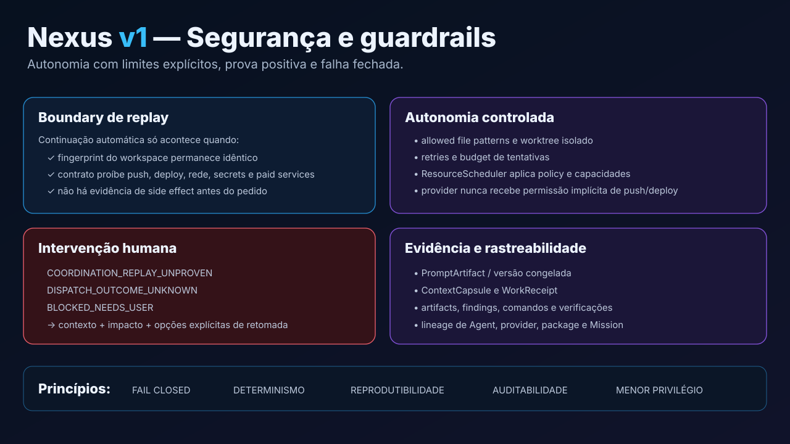

# Guardrails e segurança da execução

## Princípio

O Nexus usa **fail closed**: quando não consegue provar que uma continuação é
segura, interrompe a automação e produz uma intervenção acionável.

## Autoridade de policy

Na v1, a autoridade operacional é o `runner.AutonomyContract`, combinada com:

- isolamento do workspace/worktree;
- isolamento real do provider;
- políticas de recurso;
- validação pós-execução;
- gates determinísticos.

Metadados de Agent ou WorkPackage descrevem adequação; não concedem permissão.

## Defaults importantes

- push remoto: negado;
- deploy/publicação: negado;
- Git destrutivo: negado;
- reviewer/investigator: read-only;
- execução paralela com escrita: worktrees isolados;
- ausência de evidência: não vira sucesso.

## Replay seguro

Uma solicitação de coordenação só pode reexecutar automaticamente a package de
origem quando:

1. o fingerprint do workspace está disponível;
2. o fingerprint antes/depois é idêntico;
3. o contrato proíbe Git destrutivo;
4. push/deploy/rede/secrets/paid services não estão autorizados.

Qualquer violação produz bloqueio humano em vez de replay.

## Intervenções tipadas

Exemplos:

- `COORDINATION_REPLAY_UNPROVEN`;
- `DISPATCH_OUTCOME_UNKNOWN`;
- falha que exige mudança de escopo;
- side effect que requer autorização.

A intervenção registra pergunta, contexto, impacto e opções válidas de retomada.

## Evidência

O runtime produz e persiste evidência suficiente para auditoria:

- prompt versionado;
- Agent/revisão;
- provider/profile/model;
- workspace;
- `WorkReceipt`;
- `ContextCapsule`;
- artifacts;
- comandos/testes;
- review findings;
- resultado global.

## Segurança da Web

A API Web é local e autenticada. A URL de bootstrap é sensível e de curta
duração. Não exponha a API como serviço público sem uma arquitetura adicional
de segurança.

## Segredos

Documentação, logs, evidence bundles e relatórios devem permanecer
sanitizados. Nunca persistir deliberadamente tokens, cookies, chaves ou
transcrições privadas como “evidência”.

Veja também [Segurança](../security.pt-BR.md).
