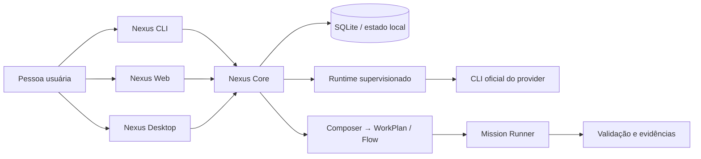

# Arquitetura

```text
Web / Desktop / CLI
          ↓
       Nexus Core
 projects · sessions · agents
 providers · workspaces · runtime
          ↓
 PTY/ConPTY · persistence · events
          ↓
 Composer → WorkPlan/Flow → Mission Runner
          ↓
 optional Maestro guidance
```

O Nexus mantém o Core operacional e oferece superfícies Web, Desktop e CLI.
Projetos, sessões, agentes, providers, workspaces e execução pertencem ao
Nexus; o Maestro é uma integração opcional para método, skills, risco e gates.



O desenho mostra as fronteiras de responsabilidade, não uma promessa de que
toda combinação de provider, Desktop e plataforma esteja certificada. Consulte
a [matriz de plataformas](../operations/platform-support.md) e os relatórios
de evidência antes de operar recursos nativos em produção.

Web e Desktop compartilham o Core quando a integração nativa está disponível.
Flow é uma projeção editável do WorkPlan, não um DAG concorrente duplicado.

Leia [runtime](runtime.md), [persistência](persistence.md), [identidade de
filesystem](filesystem-identity.md), [segurança](security.md) e
[atualizações](updates.md) para os contratos específicos.
