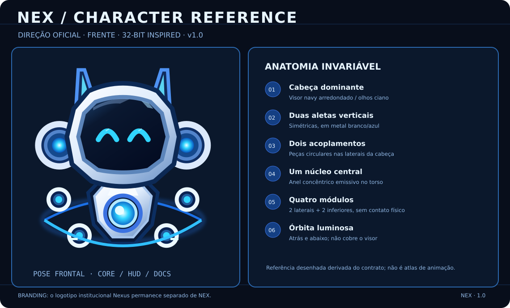
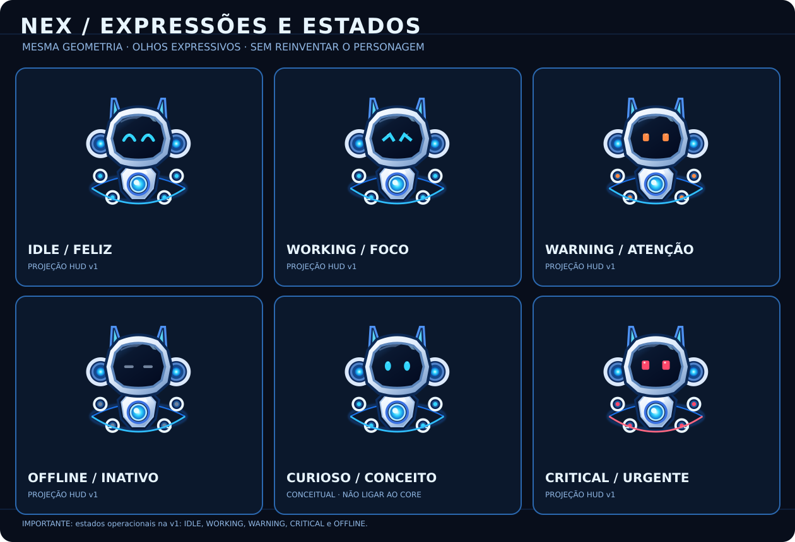
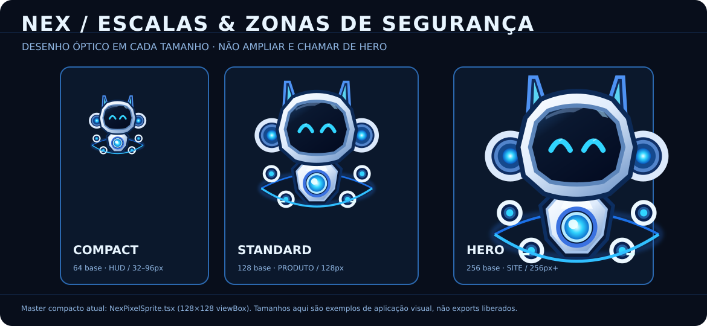

# NEX — Identidade visual oficial do mascote IAPro Nexus

**Decisão de design aprovada:** 23/10/2026  
**Produto:** IAPro Nexus, linha 1.0 (arte oficial no source, não equivalente a binário homologado)  
**Estética:** pixel art retrofuturista *32-bit-inspired*; pose **frontal** como padrão.  
**Mascote:** NEX. **Marca institucional:** logotipo Nexus permanece independente.

## Atualização de direção — 27/10/2026

O usuário confirmou **o robô da prancha NEX apresentada na conversa** como **personagem principal**, mas pediu **uma transposição para pixel art de jogo retrô com detalhamento muito maior** e muitas expressões e **ações de idle**. A identidade do personagem e a direção estética são decisões de produto; a **arte-mestre de produção ainda não foi congelada nem incorporada como binário**. A especificação executável está em [Retro Game + 12 idles](nex/RETRO_GAME_IDLE_DIRECTION.md) e a procedência da imagem principal escolhida está em [identity-lock.json](nex/identity-lock.json), com SHA-256 do arquivo enviado.

**Regra anti-deriva:** não recriar o personagem como X-Fold, N-Core, Flux ou outro mascote de forma diferente. A anatomia desta referência é preservada na arte pixelada final. O `NexPixelSprite.tsx` e suas animações CSS existentes são **fallback funcional**, não prova de que o sprite HD pixel art já foi entregue. Antes de atualizar HUD/site, criar um master editável em camadas e animações por frames com inspeção humana.

## Personagem canônico

NEX é um robô flutuante, simpático sem ser infantil, de silhueta simétrica e cabeça dominante.

1. Cabeça grande e arredondada em metal branco-frio com contorno navy, sempre frontal na pose neutra.
2. Um visor escuro arredondado, com olhos emissivos azuis que comunicam os estados operacionais.
3. Duas aletas verticais laterais e dois acoplamentos circulares azuis nas orelhas.
4. Corpo compacto, flutuante, **um** núcleo circular de energia no centro.
5. **Quatro módulos magnéticos destacados**: dois laterais e dois inferiores. Não converter em braços/pernas humanos.
6. Uma órbita/anel energético ciano-azul na zona inferior, sem cruzar rosto e visor.
7. Elementos de pixel shading claros, reflexos discretos, sem backgrounds presos no asset ou transparências falsas.

Os mesmos olhos, proporções, módulos, cores e perfil devem permanecer constantes entre estados, temas e superfícies. Vistas 3/4, perfil e costas são **apoio** para motion/marketing, não pose padrão do HUD.

## Identidade versus implementação

| Artefato | Status de decisão | Fonte e finalidade |
| --- | --- | --- |
| NEX Compact | **Arte oficial da v1 em source** | `web/src/features/hud/NexPixelSprite.tsx` — SVG em grade 128x128, exibido em ~92px no HUD |
| NEX Standard | **Estilo oficial, master específico ainda não publicado** | versão futura 128–256px otimizada para interface, onboarding e docs |
| NEX Hero | **Estilo oficial, master específico ainda não publicado** | versão futura 256px+ para site e marketing |
| Ilustrações conceituais | Referências aprovadas de linguagem, **não sprites exportáveis** | pranchas do processo de design |
| Logo/ícone Nexus | Marca institucional preservada | `assets/brand/`, `web/public/nexus-icon.png` |

A expressão “32 bits” é uma referência à estética dos jogos, **não** uma imposição de profundidade de cor, nem um limite de resolução. Não ampliar o sprite Compact e chamar de versão Hero: a versão Hero exige desenho óptico específico, consistente com o mesmo personagem.

## Paleta

- Navy profundo: `#0A1830` / superfície do visor `#030B21`.
- Azul Nexus institucional: `#3B72E1`.
- Ciano emissivo: `#31D5FF`; highlights `#DFFFFF`.
- Branco metálico: `#F2F8FF`, sombras de aço `#AAC4E2`.
- Alerta comprovado: `#FF8A45`; crítico comprovado: `#FF496C`; offline: cinza-azulado `#71839D`.

Não introduzir uma nova identidade visual substituindo a marca principal, nem permitir skins de provedores alterarem a anatomia de NEX.

## Contrato operacional da v1

O *Guardian* permanece um **modo de apresentação do HUD**. NEX não é um agente, não executa tarefas nem determina routing. Estados honestos derivados da projeção canônica:

- `idle`: olhos contentes, flutuação sutil, pulsação lenta do núcleo.
- `working`: olhos concentrados, núcleo e módulos com pulso mais rápido.
- `warning`: olhos laranja, gesto curto e balão de intervenção baseado em sinal real.
- `critical`: olhos em vermelho-rosa `#FF496C`, acionados exclusivamente quando o Companion recebe evidência crítica da projeção canônica (falha/atenção prioritária).
- `offline`: brilho reduzido, olhos neutros, **sem loop que simule atividade**.

As animações CSS são de apresentação, não barras de progresso de execução; o estado `verified` não é inferido de `working`. Estados como `thinking`, `routing` e `success` somente poderão ser ligados a telemetria própria futuramente.

A implementação atual usa componentes visuais CSS/SVG, sem WebGL ou rede; favorece `prefers-reduced-motion: reduce`, renderização pixelada e mantém o texto acessível no controle pai. O HUD conserva BAR/MASCOT/TRAY, ponte nativa, preferências e geometria.

## Atlas visual versionado para humanos e outras IAs

**A identidade do NEX é oficial; a homologação das versões executáveis continua independente.** As referências a seguir ficam no próprio repositório e devem ser analisadas antes de modificar o NEX, produzir novas poses ou criar ilustrações para o site.

### Referência principal — anatomia frontal

A vista frontal é a representação institucional padrão. As aletas, o visor, o reator e os quatro módulos orbitais constituem a assinatura física do personagem; não são efeitos ocasionais.

### Expressões e estados

A linha 1.0 vincula `idle`, `working`, `warning`, `critical` e `offline` a evidências reais. O Companion usa `attention` na apresentação e traduz esse estado visualmente para `warning`; somente atenção com severidade crítica produz `critical`. Outras expressões podem orientar ilustrações, mas **não autorizam inventar estados operacionais**.

### Variações de escala

O Compact usado pelo HUD é uma fonte React/SVG própria. As representações acima são *estudos de aplicação*, e não a publicação de masters Standard/Hero.

### Hierarquia de autoridade e resolução de conflitos

1. Este **contrato** determina anatomia, pose, paleta, linguagem e proibições.
2. `web/src/features/hud/NexPixelSprite.tsx` é a fonte executável do NEX **Compact**, não uma autoridade para redesenhar o personagem ou limitar a arte Hero.
3. As [referências desenhadas versionadas](assets/nex/README.md) orientam criação por humanos e IAs, mas **não são recortes perfeitos** das imagens conceituais geradas anteriormente.
4. Os cinco SVGs que o build exporta em `web/public/nex/` (`idle`, `working`, `warning`, `critical`, `offline`) representam os estados do Compact e não devem ser promovidos a arte Hero.
5. A **prancha raster original aprovada** foi localizada e sua proveniência registrada no manifesto: PNG 1448 × 1086, SHA-256 `4dff7d9521687f77f666a56dcf04bbe3d04dd4cd895139b1fa98df5f90f35ed5`. Seus bytes **ainda não estão commitados**; usar `node scripts/import-nex-concept.mjs --source <arquivo-original.png>` para importar com validação estrita antes de criar o commit. Não afirmar que o PNG está versionado enquanto o manifesto marcar `IDENTIFIED_BINARY_NOT_VERSIONED`.
6. Se o código divergir do desenho normativo, registrar a divergência e corrigir a implementação após revisão visual. **Não** reescrever o contrato automaticamente a partir de um resultado acidental do sprite ou de uma geração de IA.

### Instrumentação para evitar deriva

- [Manifesto machine-readable](NEX_VISUAL_MANIFEST.json) — identidade, invariantes, variantes, estados operacionais e localização dos assets; destinado a IAs e scripts.
- [Handoff/prompt para outra IA](NEX_AI_GENERATION_GUIDE.md) — instruções explícitas e resolução de conflitos.
- [Checklist de revisão visual](NEX_VISUAL_REVIEW_CHECKLIST.md) — aceite humano de fidelidade, animação, DPI, HUD e release.
- `node scripts/verify-nex-visual.mjs` — verificação estrutural rápida dos caminhos, contrato, anatomia básica e integridade dos arquivos. **Não mede similaridade perceptual**, não renderiza o mascote nem certifica um binário.
- Alterações propostas devem mostrar **antes/depois lado a lado** e identificar o SHA utilizado. Não usar imagens temporárias, URLs de chat ou desenhos gerados sem registro de aprovação como arte canônica.

### Regras específicas para geração de novas artes

Não criar diferentes personagens para Compact, Standard e Hero. Alterações de expressão não podem trocar a forma da cabeça, adicionar membros humanos, alterar a contagem de módulos ou alterar a pose frontal como default. Cada nova ilustração deve declarar: uso previsto, vista, resolução, estados (se aplicável), master/fonte, relação com o contrato, proveniência/licença e resultado da checklist. Recriar por texto isoladamente, ignorando as referências visuais, **não comprova paridade**.

---

## Governança da arte e consistência

- `NexPixelSprite.tsx` é a fonte editável de NEX Compact, inclusive as variações por mood. Ajustes de anatomia devem atualizar testes.
- Criações futuras de Standard/Hero partem das **proporções e silhueta acima**; não gerar cada estado independentemente e publicar como arte final.
- Preserve um atlas ou master em camadas se o Compact migrar de SVG para PNG/sprite sheets; pivôs, coordenadas e quantidade de módulos não variam.
- Os ícones de sistema operacional, tray e favicon **continuam exibindo o símbolo institucional do Nexus**, não uma cabeça pixelada pequena e ilegível.
- Nos sites, a identidade visual pode ser mais rica, mas a pose institucional de NEX é frontal.

## Animação articulada oficial da v1

O [contrato de animação NEX](NEX_ANIMATION_CONTRACT.md) define camadas independentes para aletas espelhadas, quatro módulos magnéticos, olhos, núcleo, sombra e órbita, sem mudar a posição frontal nem criar um novo mecanismo de telemetria. O movimento é CSS/SVG de baixa amplitude (não um atlas quadro a quadro); os cinco estados visuais continuam sendo `idle`, `working`, `warning`, `critical` e `offline`. A preferência explícita de animação desligada e `prefers-reduced-motion` devem congelar também hover e subcomponentes mesmo quando houver estilos específicos por estado.

## Gates de homologação (independentes da aprovação visual)

O visual foi **aprovado como direção de produto**, mas a release binária **não está automaticamente homologada**.

1. `bun run --cwd web quality:full` e build frontend no mesmo SHA.
2. HUD nativo Windows/macOS/Linux (X11 e Wayland), transparência real, hit testing, alça de arraste e troca BAR↔MASCOT↔TRAY.
3. Escalas DPI 100%, 125% e 150%: legibilidade, recorte, aliasing, dimensões ~108x112 DIP.
4. Estados idle/working/warning/critical/offline e `prefers-reduced-motion`: ausência de flicker, loops artificiais ou falsos alertas.
5. Documentação de evidência, SHA, artefatos e rollback. **Sem certificar Windows/macOS/Linux por inspeção estática de source.**
