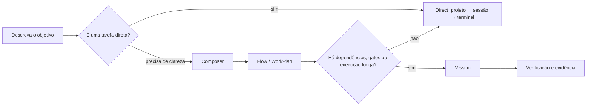

# Funcionalidades

## TL;DR

Comece com **Direct** para uma sessão de coding agent. Adote Composer, Flow e
Mission somente quando precisar de refinamento, dependências, execução longa ou
verificação centralizada.

| Objetivo | Capacidade | Status | Onde começar |
| --- | --- | --- | --- |
| trabalhar logo em um repositório | Projetos, Direct e terminal | Disponível | [Fluxo Direct](../product/direct.md) |
| manter uma especialidade operacional | Agents persistentes | Disponível | [Agentes](../product/agents.md) |
| escolher provider e acompanhar capacidade | Providers, perfis e quota | Disponível, com evidência por provider | [Providers e quota](../product/providers-and-usage.md) |
| melhorar um pedido antes de executar | Composer | Disponível | [Composer](../product/composer.md) |
| revisar etapas e dependências | Flow / WorkPlan | Disponível | [Flow](../product/flow.md) |
| acompanhar execução com gates | Mission | Experimental | [Missions](../product/missions.md) |
| delegar trabalho composto a especialistas | Delegação automática do Lead | Experimental | [Agentes](../product/agents.md) |
| aplicar método e skills externos | Maestro | Opcional / Experimental | [Maestro](../product/maestro.md) |
| operar por script | CLI e saída JSON | Disponível | [CLI](../cli/README.md) |
| diagnosticar o host | Doctor, security e status | Disponível | [Operação](../operations/README.md) |

## Como escolher a profundidade

O diagrama descreve a progressão de produto. Ele não obriga um fluxo: Direct
continua adequado para tarefas simples.

## Recursos avançados

- [Worktrees e isolamento de contexto](../architecture/filesystem-identity.md)
- [Roteamento de agents](../architecture/agent-routing.md)
- [Roteamento de recursos](../architecture/resource-routing.md)
- [Continuidade de sessão](../architecture/session-continuity.md)
- [Atualizações](../architecture/updates.md)
- [Matriz de funcionalidades](../reference/feature-matrix.md)
