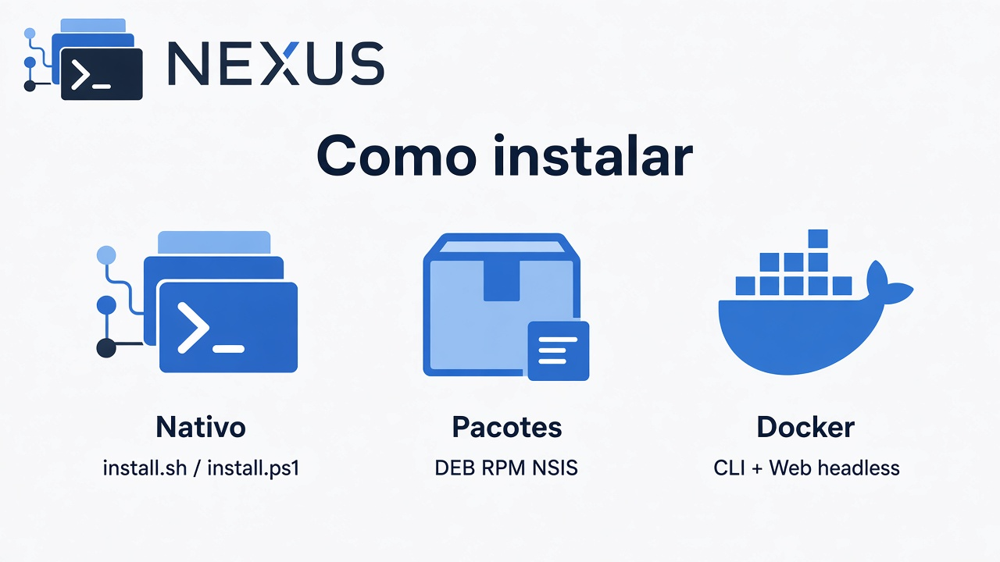

# Getting Started

Documentação de entrada do Nexus, **separada por caminho de distribuição**.

| Documento | Escopo |
| --- | --- |
| [Instalação nativa](installation.md) | `install.sh` / `install.ps1`, release assinada, upgrade, uninstall, Web e doctor |
| [Pacotes e artefatos](packages.md) | DEB, archives de CLI e Desktop; formatos futuros são marcados explicitamente |
| [Docker (compatibilidade)](docker-compat.md) | `docker-compose.yaml`, host-parity, providers no container |
| [Primeiro projeto](first-project.md) | Fluxo pós-instalação no produto |
| [Visuais (ajuda/divulgação)](visuals.md) | Banners e infográficos |

Decisão de arquitetura do Docker: [ADR-docker-compat-host-parity](../architecture/ADR-docker-compat-host-parity.md).

Matriz de plataformas: [platform-support](../operations/platform-support.md).
