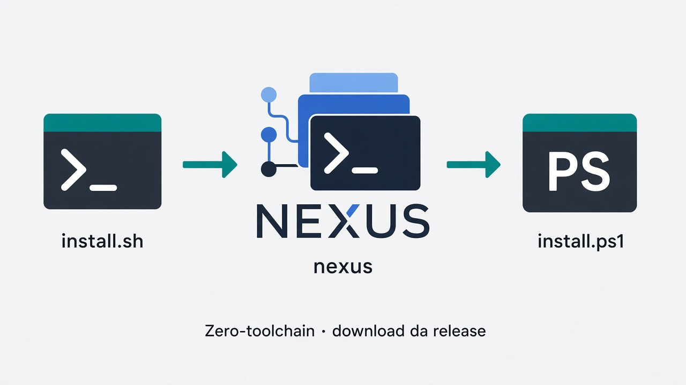

# Instalação nativa por release assinada



O caminho recomendado para usuários de uma release é instalar os artefatos
pré-compilados publicados no repositório **binário** do Nexus. O source pode
permanecer privado; o bootstrap do cliente não depende de acesso ao repositório
de código.

Este guia não cobre Docker nem desenvolvimento a partir do source.

| Quero… | Documento |
| --- | --- |
| DEB e matriz de artefatos nativos | [Pacotes e artefatos](packages.md) |
| Rodar no Docker (CLI + Web) | [Docker compatibilidade](docker-compat.md) |
| Compilar o source como desenvolvedor | [Build](../../BUILD.md) |
| Índice getting-started | [README](README.md) |

## Release pública atualmente documentada

A documentação pública mantém `v1.0.0-beta.1` como última beta publicada
registrada. A versão do source candidato pode ser superior e **não** implica que
o mesmo tag já esteja distribuído.

Enquanto a linha pública for beta, use a tag beta explícita. O valor
`latest` consulta o endpoint `releases/latest` do GitHub, que representa a
release mais recente marcada como latest/não-prerelease; ele não é um atalho
confiável para “beta mais nova”.

## Linux / macOS

Baixe o próprio instalador da release binária imutável e depois execute-o
pinando a mesma versão:

```bash
curl -fsSL \
  https://github.com/IAPro-Community/nexus-releases/releases/download/v1.0.0-beta.1/install.sh \
  -o install.sh

bash install.sh --version=v1.0.0-beta.1
nexus doctor
nexus web
```

Pré-requisitos do caminho pré-compilado:

- `curl` ou `wget`;
- `tar`; para Desktop macOS, `ditto` nativo é usado;
- `sha256sum` ou `shasum`;
- Python 3 com o pacote `cryptography`, usado para verificar Ed25519;
- WebKitGTK somente para o Desktop Linux.

O instalador aceita, entre outros:

```text
--no-desktop
--no-path
--install-dir=<path>
--with-maestro
--version=vX.Y.Z
```

`NEXUS_INSTALL_DIR` é o equivalente por ambiente. `NEXUS_RELEASE_REPO` e
`NEXUS_RELEASE_BASE_URL` existem para distribuição interna/certificação; não
são necessários no fluxo normal do cliente.

## Windows PowerShell

```powershell
irm https://github.com/IAPro-Community/nexus-releases/releases/download/v1.0.0-beta.1/install.ps1 -OutFile install.ps1
.\install.ps1 -Version v1.0.0-beta.1
nexus doctor
nexus web
```

Pré-requisitos:

- PowerShell;
- Python 3 com `cryptography` para a verificação Ed25519;
- WebView2 somente para o Desktop Windows.

Parâmetros principais:

```text
-NoDesktop
-InstallDir <path>
-WithMaestro
-Version vX.Y.Z
```

O Windows ARM64 pode receber o CLI quando o archive correspondente estiver
publicado, mas o Desktop v1 atual é produzido/certificado somente em Windows
x86_64. Ausência de Desktop não invalida a instalação do CLI.

## O que o instalador verifica

A instalação é **fail closed**. Para um release pinado, o fluxo é:

```text
update-manifest.json
  + update-manifest.sig
          |
          v
Ed25519 com trust root embutida
          |
          v
SHA-256 do artifact
          |
          v
extração segura
          |
          v
nexus version --json
          |
          v
versão interna == versão solicitada
          |
          v
substituição do binário
```

Se assinatura, hash, artifact, extração ou versão interna divergirem, o binário
não é aceito.

A chave pública e o key ID usados pelo build de release são versionados no
source por `UPDATE_PUBLIC_KEY` e `UPDATE_KEY_ID`; o workflow de publicação
falha quando os secrets protegidos divergem desses contratos.

## Upgrade

Para uma versão dentro do mesmo canal:

```bash
nexus update check
nexus update
```

Instalações gerenciadas por pacote não são sobrescritas silenciosamente pelo
self-updater; o Nexus orienta o comando do gerenciador correspondente.

Para migrar deliberadamente de uma beta para a linha stable, use a versão
stable pinada com o instalador assinado ou, em versões que suportem a opção de
canal, use `nexus update --channel stable`. A troca de canal é explícita; um
cliente beta não deve ser promovido silenciosamente para stable.

## Desinstalação

Os uninstallers também são publicados como assets da release.

### Linux / macOS

```bash
curl -fsSL \
  https://github.com/IAPro-Community/nexus-releases/releases/download/v1.0.0-beta.1/uninstall.sh \
  -o uninstall.sh

bash uninstall.sh
```

Por padrão, binários e launchers gerenciados pelo Nexus são removidos e dados
do usuário são preservados. Para remover também dados/configuração Nexus:

```bash
bash uninstall.sh --purge-data
```

### Windows

```powershell
irm https://github.com/IAPro-Community/nexus-releases/releases/download/v1.0.0-beta.1/uninstall.ps1 -OutFile uninstall.ps1
.\uninstall.ps1
```

O uninstaller Windows preserva perfis e dados de projeto.

## Desenvolvimento a partir do source

O source é um caminho de engenharia, não o bootstrap recomendado de cliente.

Requisitos: Go 1.25+, Bun 1.3.9+, Git e Make.

```bash
git clone https://github.com/IAPro-Community/nexus.git
cd nexus
bun --cwd web install --frozen-lockfile
make build
./nexus version
./nexus doctor
```

Também existem `./install.sh --build-from-source` e
`.\install.ps1 -BuildFromSource` para ambientes de desenvolvimento com
acesso ao source.

## Diagnóstico

```bash
nexus doctor --json
```

No Docker, probes de Desktop/WebView2/ConPTY aparecem como N/A. Veja
[Docker compatibilidade](docker-compat.md).

## Próximo passo

[Primeiro projeto](first-project.md)
