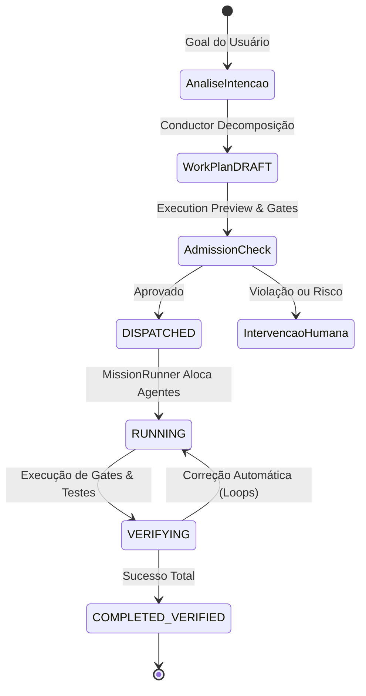

# Conductor

Conductor é a camada de decisão/decomposição que transforma um objetivo composto
em trabalho estruturado usando os contratos já existentes do Nexus.

Ele **não** é um segundo runtime ou uma segunda engine de orquestração.

```text
Objetivo
  ↓
classificação / decomposição
  ↓
WorkPlan
  ↓
Flow / Mission
  ↓
MissionRunner
```

## Responsabilidade

Conductor pode decidir entre:

- manter trabalho simples no caminho Direct;
- decompor um objetivo substancial;
- selecionar um preset de Mission Team;
- produzir packages/dependências que seguem o pipeline canônico.

Antes da transferência de ownership, o Conductor congela o objetivo como
`GoalContract` no WorkPlan e no `ExecutionSnapshot`. Depois que existe
`run_id`, execução pertence ao `MissionRunner` e não pode ser repetida
automaticamente no Lead.

## O que Conductor não faz

- não cria provider diretamente;
- não substitui ResourceScheduler;
- não substitui AgentMatcher;
- não mantém uma segunda cópia do plano;
- não executa uma state machine paralela;
- não concede push/deploy implicitamente.

## Tarefas simples

Uma correção localizada não deve ser inflada para uma Mission multi-Agent.
Classificação considera complexidade, dependências, risco e custo de
coordenação.

## Objetivos compostos

Features, mudanças de arquitetura, release/security work e refactors maiores
podem ser decompostos em fases como:

```text
Planning → Implementation → Review → Verification
```

O preset descreve papéis/requisitos; não fixa providers.

## Superfícies

A disponibilidade concreta dos comandos/superfícies do Conductor pode evoluir
durante o fechamento da v1. Para evitar documentação contraditória, trate
`nexus --help`, a [matriz de funcionalidades](../reference/feature-matrix.md)
e o source da revisão instalada como referência de interface.

O fluxo de produto na Web para planejamento continua centrado em
**Composer → WorkPlan/Flow → GO → Mission**.

## Segurança

Conductor respeita as mesmas boundaries da execução:

- plano aprovado;
- worktree/policies;
- AgentMatcher + ResourceScheduler;
- AutonomyContract;
- gates/evidence;
- intervenção humana quando necessário.

Veja [Como funciona](how-it-works.md), [Missions](missions.md) e
[Guardrails](../architecture/guardrails.md).


## Boundary de promoção interativa

`StartDispatch` separa preparação/admissão de espera do run. A revisão recém
gerada passa pelo mesmo caminho de Execution Preview, budget/cost gate e strict
admission usado pelo GO explícito. Enquanto essa etapa não termina, o terminal
mantém o prompt no provider.

- `fallback_safe=true`: o Core provou que nenhum `MissionRun` iniciou;
- `admission_blocked=true`: uma política/check conhecido recusou a Mission;
- `admission_stage`: indica a etapa que falhou;
- após `ACCEPTED + run_id`, fallback Direct automático é proibido.

Essa distinção é usada por CLI e Web para impedir tanto perda de prompt quanto
dupla execução.

## Comandos da CLI & Disparo Autônomo

O Conductor é a inteligência por trás dos comandos de autonomia de alto nível da CLI:

```bash
# Execução autônoma completa em foreground
nexus run "Implementar autenticação OAuth2 com GitHub e testes de integração"

# Disparo explícito com compilação de WorkPlan
nexus conductor dispatch "Auditar e corrigir vulnerabilidades de dependências no backend Go"
```

### Ciclo de vida da execução



Durante a execução, o Conductor monitora o progresso de cada fase do grafo DAG gerado, assegurando que o especialista adequado (`Architect`, `Implementer`, `Reviewer`, `QA`) execute cada tarefa dentro dos limites estabelecidos de tempo, arquivos e quota.
