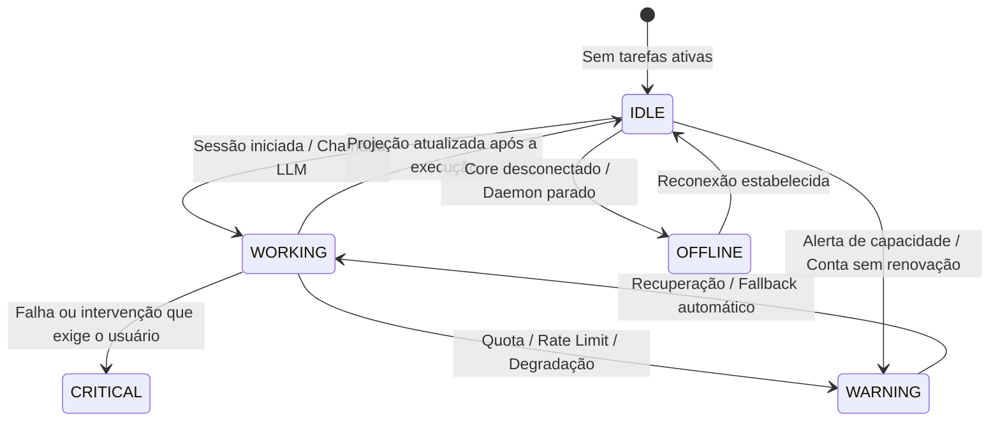

# Nexus HUD

> **Estado atual:** implementação do HUD está na linha `release/v1.0.0`. As referências a M1 e branches anteriores abaixo são histórico de design, não o estado de entrega. A certificação do HUD desktop exige execução nativa no mesmo SHA em Linux, Windows e macOS; veja [suporte de plataformas](../operations/platform-support.md).
>
> O Nexus HUD é uma superfície de apresentação. Ele não é um segundo Capacity
> Monitor, scheduler, cost engine, runtime de Agents ou MissionRunner.

## Objetivo

O HUD mantém o estado operacional do Nexus visível sem exigir que o usuário
permaneça na superfície Usage. Existem duas experiências oficiais:

- **Web HUD**: superfície persistente no Nexus Web OS, com adaptação para mobile.
- **Desktop HUD**: gadget nativo independente da janela principal, conectado ao
  mesmo Core/API.

A arquitetura é:

```text
Capacity Monitor ─────┐
ResourceScheduler ────┤
Cost Intelligence ────┤
Agents / Runtime ─────┤
MissionRunner ─────────┤
                      ↓
                 HUD Projection
                      │
              ┌───────┴───────┐
              ↓               ↓
          Desktop HUD       Web HUD
```

## Regras de honestidade

- `UNKNOWN` permanece `UNKNOWN`.
- dados stale/unavailable não são apresentados como atuais;
- custo `PROVIDER_REPORTED`, `API_EQUIVALENT_ESTIMATE`, `INFERRED` e
  `UNKNOWN` preserva a proveniência do ledger;
- o HUD não executa provider CLIs e não cria probes;
- alertas usam o estado/triagem canônicos do Capacity Monitor;
- recomendações usam o ResourceScheduler; o frontend não recalcula ranking;
- sucesso de Mission deriva do MissionRunner/evidence, nunca do texto do modelo;
- o HUD não utiliza LLM.

## M1

A primeira vertical slice deve conter:

1. projeção backend read-only e testável;
2. Web HUD persistente, com modo compacto e expansão;
3. adaptação mobile apropriada;
4. HUD Desktop Linux independente da janela principal;
5. Capacity e recomendação canônica;
6. preferências de apresentação separadas das preferências do Capacity Monitor;
7. feature flag experimental;
8. acessibilidade e testes.

Agents, Missions, Cost e alertas entram na projeção desde que possam ser
consumidos sem criar lógica paralela; UX operacional completa continua sendo
expandida nos milestones seguintes.

## Recomendação de recurso

O HUD não solicita uma recomendação nova durante refresh. Quando o Capacity
Monitor entra em `WARNING`, `CRITICAL` ou `EXHAUSTED`, ele reutiliza o
recommender canônico do ResourceScheduler uma única vez na transição e persiste
a recomendação no mesmo evento durável de Capacity.

A projeção do HUD somente apresenta essa recomendação se o `fingerprint` do
evento ainda corresponder a um estado degradado atual e não estiver
acknowledged/snoozed. Depois de recovery, a recomendação antiga desaparece.

Se não houver recomendação canônica vigente, o HUD não inventa uma alternativa e
a superfície Resource permanece ausente/UNKNOWN. Contextos futuros de
Mission/Agent podem projetar recomendações contextuais próprias desde que venham
do mesmo ResourceScheduler, sem recalcular scoring no HUD.

## Preferências

Preferências do HUD são de apresentação e não alteram
`CapacityMonitorPreferences`.

Comuns:

- enabled;
- mode: `AUTO | CAPACITY | RESOURCE | AGENT | MISSION | ALERT | MINIMAL`;
- providers visíveis;
- capacity/agents/missions/cost/recommendation;
- densidade;
- theme;
- privacy mode.

Desktop adiciona placement, display, opacity, always-on-top, snap e auto-hide.
Web adiciona dock/floating e posição dentro da viewport.

## Prioridade AUTO

A prioridade é determinística e não usa LLM:

```text
CRITICAL alert
> human intervention
> Mission blocked
> Agent running
> Resource recommendation
> Capacity summary
```

A implementação deve reutilizar enums/estados canônicos sempre que existirem.

## Desktop process model

No milestone M1 histórico, o projeto usava Wails v2.15.0, que disponibilizava uma janela por aplicação. O HUD foi isolado em um processo de apresentação independente. A release 1.0 atual já usa Wails v3, mantendo o shell nativo independente.

A estratégia do M1 é um shell Wails leve `nexus-hud`:

- contém apenas apresentação e integração nativa;
- conecta-se ao mesmo loopback Core/API quando disponível;
- não possui Capacity Monitor, scheduler, cost engine ou MissionRunner próprios;
- mantém isolamento de falha da superfície;
- usa o lease já existente do Capacity Monitor caso seja necessário iniciar um
  Core local na ausência de outro processo.

A migração para Wails v3 foi incorporada sem duplicar o contrato `HUD Projection`. Uma eventual consolidação de janelas é uma decisão de produto posterior.

## Plataformas

A matriz oficial permanece em
[`docs/operations/platform-support.md`](../operations/platform-support.md).

Estado após o merge do M1:

| Superfície | Estado |
| --- | --- |
| Web | **PASS** no M1 |
| Linux Desktop HUD | **PASS** no M1 nativo/X11 |
| Windows Desktop HUD | gate nativo obrigatório na frente cross-platform |
| macOS Desktop HUD | gate nativo obrigatório na frente cross-platform |

A implementação cross-platform integra o source candidato; execução certificada depende dos gates por plataforma e SHA.
Cross-compilation não altera esses estados e nenhum recurso novo de produto deve
passar à frente da paridade nativa.

## Privacidade

Privacy Mode deve ocultar identificadores sensíveis de apresentação (conta,
workspace/projeto, session identifiers e custo quando configurado) sem alterar
o estado operacional básico de provider/capacidade.

Segredos, tokens OAuth/API e conteúdo privado de conversas nunca pertencem à
projeção.

## Acessibilidade

O HUD deve suportar teclado, foco visível, nomes acessíveis completos,
percentuais textuais, reduced motion, high contrast e zoom/scaling. Informação
não pode depender apenas de cor ou ícone.

## Performance

A superfície não cria polling de provider. Atualizações são derivadas do Core,
eventos existentes e revalidação centralizada/bounded. O objetivo do Desktop HUD
em idle é CPU praticamente zero; métricas devem ser registradas no relatório de
entrega antes de qualquer claim estável.

## PWA

**Decisão M1: DEFERRED.**

O Web HUD não depende de PWA e já é uma superfície oficial do Nexus Web OS. O
frontend atual não possui um service worker/manifest canônico que possa ser
estendido sem introduzir uma nova política de cache, atualização e recuperação.

Adicionar PWA no primeiro milestone aumentaria o blast radius do fechamento sem
resolver uma dependência funcional do HUD. A evolução para installable web app,
standalone mode, browser notifications e badge continua prevista para o
milestone de UX avançada, desde que:

- reutilize o pipeline de notifications existente;
- não crie cache paralelo de estado operacional;
- invalide dados de Capacity/Agents/Missions corretamente;
- não apresente estado stale como atual;
- possua estratégia explícita de update/rollback do service worker.

## Limitações conhecidas do M1

- Windows e macOS continuam `UNVERIFIED` até execução nativa same-SHA.
- No M1 histórico (Wails v2), work area, ID estável de display e scale factor eram limitados. A release atual em Wails v3 expõe esses dados; suporte completo de multi-monitor/DPI ainda requer smoke nativo no SHA vigente.
- always-on-top/posicionamento absoluto no Wayland depende do compositor e deve
  ser capability-detected.
- tray/menu bar só vira claim quando houver implementação e teste nativos.
- PWA é melhoria não bloqueante até existir decisão específica baseada no Web
  atual.


## NEX — identidade do mascote único

Na linha 1.0, o **NEX Compact** é o único mascote oficial. A apresentação nativa **MASCOT** mostra essa arte e estados derivados dos dados do Nexus. Barra e Bandeja são apresentações do HUD, não personagens adicionais. A conclusão de uma missão, por si só, não produz um estado visual de sucesso; essa expressão depende de telemetria verificada própria.

Veja [identidade visual oficial](../design/NEX_32BIT_VISUAL_CONTRACT.md) e [guia do HUD nativo](hud-guardian-v1.md). O código-fonte da arte não certifica sozinho uma release ou plataforma.

## Minimal taskbar capsule (October 2026)

The HUD's compact surface is an always-on-top **capsule above the system taskbar**, not an unsupported injection into Windows Taskbar. New desktop installations display the animated Guardian Mascot in a 108 × 112 DIP window. Users may select the legacy 220 × 60 DIP bar (whose capsule uses about 174 × 43 pixels next to a 24 px drag grip) or the tray-only mode. It uses the official Nexus icon, one highlighted provider and its limiting-window remaining percentage.

The capsule is intentionally a **projection**, not a control plane:
- When a running Agent or Mission identifies a provider/profile, this is the account in execution. Otherwise the highlighted measurable account is labeled *Recurso em destaque*, **never** *Conta ativa*.
- Unknown or offline quota uses an em dash, a neutral ring and an explanation; neither means 0% or unlimited.
- Displayed warning severity originates in the Capacity Monitor. Provider alternatives are informational and sorted for readability, **not** treated as the ResourceScheduler's recommendation.
- If there is an active canonical ResourceScheduler recommendation it may be shown with a link to the existing Usage surface. The HUD never performs a silent account switch.
- Subscription capacity, API costs and per-request tokens are different resource channels; the capsule does not derive one from another.

Behaviors:
1. **Idle**: branded capsule, one highlighted provider and remaining capacity.
2. **Hover (Web)**: short non-interactive tooltip with window and renewal evidence.
3. **Click**: popover with highlighted resource, up to three alternatives, interventions and optional canonical recommendation.
4. **Warning/critical**: colored ring, capacity events and acknowledge/snooze via existing endpoints.
5. **Unknown/offline**: neutral ring, unknown remaining quota and last observed connection when available.

Desktop Wails v3 has a transparent independent native window and native tray recovery. The window starts anchored above the taskbar, and resizing to the selected expanded preset keeps its bottom-right edge anchored. **Rich hover content on Native is not yet feature-equivalent with Web**: native currently exposes a standard tooltip, since a separate temporary hover window needs capability-specific implementation and testing. This limitation must not be described as full parity.

Native validation requires exact-SHA Windows/Linux/macOS smoke, taskbar positioning, DPI/multi-monitor, window restoration, tray recovery, and click-through tests for transparent empty regions. Browser E2E should capture compact, hover and expanded states and run accessibility checks. No production release claim follows from merely committing the UI.

## Arraste e presets de tamanho do HUD nativo (2026-10-21)

O HUD nativo separa duas intenções: **clique** abre ou fecha o resumo; **arraste** move a janela. Para não transformar um clique com pequena oscilação em arraste, a cápsula continua com `--wails-draggable: no-drag` e recebe uma alça dedicada de 24 px com ícone de grip. O cabeçalho do popover também é uma região arrastável. A alça aceita foco e setas: 16 px por pressionamento, 64 px com `Shift`, sempre limitada à work area do monitor.

Os tamanhos são presets explícitos, não dimensões inventadas pela UI:

| Preset | Janela compacta | Janela expandida |
| --- | --- | --- |
| `compact` (Compacto) | 220 × 60 | 334 × 496 |
| `comfortable` (Confortável) | 260 × 70 | 380 × 560 |
| `large` (Grande) | 320 × 84 | 440 × 640 |

Ao trocar de preset, a borda inferior direita é preservada, o estado é salvo em `hud-window-state.json` e o primeiro show reaplica a geometria persistida. Isso corrige o primeiro paint em 190 × 48 (mínimo do Wails) que cortava a cápsula. Os rótulos e o texto de tamanho atual são localizados em pt-BR, inglês e espanhol; os controles ficam no popover nativo.

**Evidência local, não certificação de release:** Windows 11 `10.0.26200`, scale 100%, binário de homologação isolado construído no worktree sobre `f6098b8c684a97bf7e8e56804109ca491c78cfa2`. A UI Automation encontrou os botões acessíveis `Compacto`, `Confortável`, `Grande` e `Arrastar HUD. Use as setas para mover.`; a sequência real mediu `220×60 → 334×496 → 380×560 → 440×640 → 334×496 → 220×60`. O arraste moveu a janela em `-144,-108` px, as setas moveram `+16` px e `Shift`+seta `+64` px, e após reiniciar o HUD abriu em `260×70` na posição persistida.

**Limites:** Linux e macOS permanecem `NOT_TESTED` para este slice; não há tag, assinatura ou alegação de GO. O redimensionamento livre pelas bordas não é um preset certificado; use os três presets para uma geometria suportada. O HUD Web não recebe esses controles nativos.

## Correções de estabilidade do HUD compacto (18/10/2026)

- Restauração força a janela nativa de volta a 220×60 DIPs, preservando a âncora inferior direita do monitor. Isso evita a reabertura invisível de uma janela expandida após reiniciar.
- Expansão/recolhimento consulta a dimensão **real** da janela nativa, não apenas a última dimensão persistida.
- O provider só pode ser denominado *Conta em execução* quando provider **e** profile correspondem à identidade de Agent em execução; nomes de provider isolados não identificam contas múltiplas.
- Missions não terminais voltam a aparecer na visão expandida. Intervenções humanas têm prioridade e histórico terminado não substitui execução corrente.
- Percentuais `ESTIMATED` são marcados com `~` e indicador tracejado; `CACHED` é identificado como cache; origem não confiável/sem dados usa `—`.
- Testes unitários cobrem identidade incompleta, evidência de quota, Missions ativas/terminadas e restauração de geometria antiga/expandida.

A validação Windows anteriormente executada permanece como evidência histórica para os SHAs testados. **Estes novos commits não herdam homologação Windows exata**: os gates, o smoke real do HUD, a restauração após reinicialização e as evidências visuais precisam ser executados novamente no HEAD final. Não publicar tag ou release com base apenas no registro anterior.


> **Cost evidence:** `PROVIDER_REPORTED` means a value present in the
> provider's usage telemetry, **not** an invoice or proof of a charge.
> The HUD labels this evidence `reported`. `API_EQUIVALENT_ESTIMATE`
> and `INFERRED` remain estimates; no subscription token valuation is
> merged into confirmed billing. An offline native HUD is never marked
> ready solely because a previous snapshot remains in memory.

## Incidente: cápsula nativa sem popup (2026-10-20)

**Causa reproduzível por inspeção do contrato:** o Core respondia `enabled:false`
porque `flags.HUD` era desligado por padrão, embora `nexus-hud` fosse instalado
sem `NEXUS_ENABLE_HUD=1`. A apresentação nativa interpretava `disabled/offline`
como `waiting` e o clique somente executava refresh; `SetHUDExpanded` nunca
era chamado. O E2E Web ativava a flag artificialmente, mascarando o problema.

**Política corrigida:**
- A projeção de leitura (autenticada, sem probes de provider) agora está habilitada
  por padrão para permitir o HUD nativo pronto para uso.
- `NEXUS_DISABLE_HUD=1` mantém o kill switch de backend prioritário, sem contorno
  pela UI; no estado desativado, a cápsula nativa deve abrir um diagnóstico.
- O widget Web continua **opt-in** por preferência local; API ativa não significa
  widget Web obrigatório.
- O clique chama `SetHUDExpanded` e só considera a expansão concluída depois do
  sucesso da chamada Wails. Falhas registram erro e não fingem popup aberto.
- Se a projeção estiver desativada/offline, a janela pode ser expandida e mostrar
  detalhes de indisponibilidade, atualizar e abrir o Nexus, sem falsificar quota.

**Gates obrigatórios antes do GO:** executar o **mesmo SHA** do Core e HUD nativo
atualizados; a mera atualização do frontend enquanto um Core antigo estiver rodando
não corrige o retorno `enabled:false`. No Windows e Linux, verificar em sessão
gráfica interativa, com `NEXUS_ENABLE_HUD` e `NEXUS_DISABLE_HUD` não definidos:

1. A cápsula abre ao clicar, com cerca de **334 × 496 DIPs** para o popover.
2. Segundo clique ou botão de fechar recolhe para **220 × 60 DIPs**.
3. Com duas contas no mesmo provider, a conta em execução só é exibida se
   `provider+profile` estiverem verificados.
4. Com perda de conexão ao Core, o clique abre um diagnóstico (não ignora o evento).
5. Com `NEXUS_DISABLE_HUD=1` no Core, o diagnóstico informa a indisponibilidade;
   o kill switch não é ignorado.
6. Validar posição junto à barra de tarefas, DPI, dois monitores e reinício.
7. Arquivar screenshot da cápsula e popup, gravação do clique e evidência de
   `aria-expanded=true`, API `enabled` e geometria nativa, sempre no mesmo SHA.

**Não há paridade pixel-perfect certificada com o mockup.** O hover no HUD nativo
continua simples, e o E2E Web não substitui teste do clique real Wails/GTK/WebView2.
A correção de código não equivale a homologação nativa até os gates acima passarem.

## Contrato de moldura nativa — Windows, macOS e Linux (21/10/2026)

A cápsula nativa deve ter transparência visual real **sem a sombra retangular
projetada pelo sistema operacional**. A sombra arredondada do componente CSS
continua pertencendo à apresentação da cápsula.

- Windows (Wails v3 / WebView2): `Windows.DisableFramelessWindowDecorations=true`
  remove a sombra e os cantos DWM da janela frameless.
- macOS (Wails v3 / WKWebView): `Mac.DisableShadow=true` desativa a sombra
  `NSWindow`; `Mac.CornerType=MacWindowCornerTypeSquare` impede que o formato
  dos cantos da janela imponha uma moldura nativa ao conteúdo transparente.
- Linux (Wails v3 / GTK): `Frameless=true` e
  `BackgroundTypeTransparent` já eram usados. O contrato agora declara também
  `Linux.WindowIsTranslucent=true`, mas a biblioteca Wails beta.25 não fornece
  um `DisableShadow` equivalente; a sombra externa continua sob controle
  do tema e do compositor, especialmente em X11 e Wayland.
- Os três sistemas mantêm `Frameless=true`,
  `BackgroundTypeTransparent`, fundo RGBA com alpha 0, tamanhos persistidos e
  `AlwaysOnTop` conforme preferência do usuário, quando o gerenciador de janelas
  suporta esse comportamento.
- O código centraliza essas opções em `cmd/nexus-hud/window_options.go`.
  `cmd/nexus-hud/window_options_test.go` protege esse contrato, executado nos
  gates nativos Windows e macOS, além do gate de contrato no CI Linux.
  Esses testes verificam opções de criação de janela, não pixels renderizados.

**Limite de escopo:** remover sombra/moldura visual **não equivale** a permitir
cliques através de todos os pixels transparentes da WebView. Também não torna a
janela livremente redimensionável; o contrato existente oferece arraste por alça
e presets de tamanho. Hit-testing nativo por região é uma melhoria separada, que
não deve ser simulada com CSS nem anunciada como pronta.

**Aceitação visual obrigatória no mesmo SHA, antes de GO:**

1. No Windows 10/11, capturar cápsula compacta e popup aberto; verificar
   ausência de sombra quadrada, halo da janela e retângulo opaco.
2. No macOS arm64, repetir as capturas em sessão gráfica real; verificar ausência
   da sombra retangular do NSWindow, cantos nativos aparentes e flashes opacos.
3. Em ambos: mover pelo handle, aplicar presets, abrir/recolher popup, alternar
   foco, reiniciar e confirmar geometria/posição e ausência de regressões.
4. Registrar explicitamente áreas transparentes que ainda bloqueiam clique no
   desktop: **falha conhecida de input, não aprovação de click-through**.
5. Linux: repetir os testes de sombra, transparência, alça de arraste e
   popup no X11 e Wayland quando disponíveis; distinguir GTK3/GTK4, tema
   GNOME/KDE e capacidade do compositor. O smoke Xvfb/CI verifica inicialização,
   mas não comprova ausência de sombra ou click-through no desktop real.
6. Relacionar screenshots, logs, build e resultado ao SHA exato da release.
   Go unit PASS ou smoke de processo vivo não substituem comparação visual.

Sem evidências nativas para **Windows, macOS e Linux** no mesmo SHA, a
**paridade visual cross-platform** permanece `UNVERIFIED`. No Linux, a sombra
gerada pelo compositor ou tema GTK não é controlada pelas flags Windows/macOS;
se o retângulo persistir, o caminho é um adaptador GTK/compositor específico
ou redesign da superfície, não alegar correção por flag.

---

## Modos de Apresentação e Mascote NEX

O Desktop HUD oferece três apresentações: Barra, Mascote e Bandeja. A apresentação Mascote usa uma única arte oficial NEX, com expressão e animação dirigidas pelos estados reais do Nexus. Barra e Bandeja são formas de exibição do HUD, não outros personagens.

| Modo | Descrição e Finalidade |
| --- | --- |
| **Barra** | Barra flutuante translúcida contendo telemetria compacta de quotas, conta em destaque e status de degradações. |
| **Mascote** | Projeção do único mascote oficial NEX, flutuando sobre o desktop com expressões e estados visuais ligados à saúde real do sistema. |
| **Bandeja (Tray)** | Modo recolhido silencioso na bandeja do sistema operacional, exibindo alertas apenas quando ocorre saturação ou rate limit. |

### Humores Operacionais do Mascote NEX



- **IDLE**: Respiração ambiente sutil, visor azul calmo, módulos orbitais estáveis.
- **WORKING**: Pulsos de computação no núcleo reator circular, visor focado, módulos orbitais em rotação ativa.
- **WARNING**: Núcleo reator âmbar/amarelo, alertas visuais de degradação de quota ou rate limit detectado nas janelas de 5h/7 dias.
- **CRITICAL**: Núcleo vermelho para falha ou intervenção prioritária, com acesso ao item correspondente no HUD.
- **OFFLINE**: Mascote em repouso/desconectado, reator apagado, indicando perda de sinal com o Core local.

### Particularidades do Wayland no Linux

No Wayland (GNOME Shell / KDE Plasma / Sway), o protocolo de segurança do compositor proíbe clientes de definir posições globais absolutas de janelas secundárias na tela. Por isso:
- O botão **Popup independente** é automaticamente desativado exibindo *"Indisponível no Wayland"*.
- O popup de detalhes de quotas permanece firmemente ancorado dentro da janela principal do HUD para prevenir janelas órfãs fora da área visível.
