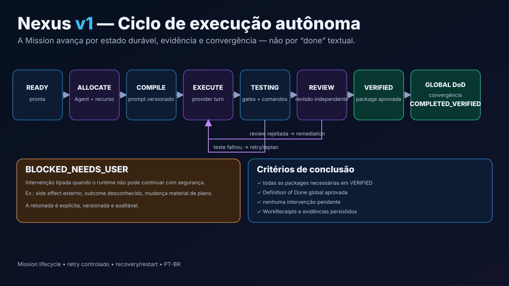

# Missions e Autopilot

Mission é a execução durável de um **WorkPlan aprovado**. Ela existe para
trabalho que precisa de dependências, múltiplos Agents, isolamento, retries,
gates, recovery ou verificação global.



## Quando usar

Use Mission quando existir pelo menos um destes fatores:

- várias etapas dependentes;
- execução longa;
- paralelismo;
- múltiplos especialistas;
- revisão independente;
- testes/gates obrigatórios;
- necessidade de recovery/restart;
- risco que justifique intervenção humana explícita.

Para uma mudança pequena, Direct ou Composer → Agent continua sendo melhor.

## Ciclo de uma package

```text
READY
  → ALLOCATE
  → COMPILE
  → EXECUTE
  → TESTING
  → REVIEW
  → VERIFIED
```

O `MissionRunner` persiste cada transição. Provider output não pode marcar uma
package como verificada por conta própria.

## GO e revisão congelada

A execução inicia após uma autorização explícita sobre uma revisão do plano.
Isso evita que a Mission execute silenciosamente um plano que mudou depois da
aprovação.

## Alocação

A package descreve requisitos. O fluxo de seleção é:

```text
TaskRequirements
  → AgentMatcher: quem deve executar
  → ResourceScheduler: com qual provider/profile/model
```

Preferência de provider é diferente de `PIN`. Fallback de recurso não troca a
identidade persistente do Agent.

## Contexto

Cada package recebe um `ContextCapsule` limitado. Ele pode incluir:

- objetivo da package;
- dependências;
- receipts das dependências;
- relevant paths;
- critérios de aceite;
- constraints;
- handoff metadata;
- skills selecionadas.

Transcrições completas de providers não são usadas como memória canônica.

## Evidência

Ao terminar, uma package produz `WorkReceipt` com resultado e evidência.
Dependendo da package, isso pode incluir:

- arquivos alterados;
- comandos;
- testes;
- artifacts;
- review findings;
- revisão Git;
- Agent executante.

## Retry e remediation

Falhas de teste ou review podem retornar ao ciclo de execução. A Mission aplica
limites de retry, detecção de no-progress e estratégia de remediation.

Repetir indefinidamente a mesma abordagem não é considerado progresso.

## Coordenação entre Agents

Durante uma execução, um Agent pode solicitar:

- `NEED_INFO`;
- `ARTIFACT_REQUEST`;
- `REVIEW_REQUEST`;
- `DELEGATE`.

Esses pedidos passam pelo MissionRunner e são duráveis. Veja
[Coordenação entre Agents](agent-coordination.md).

## Intervenção humana

Quando não é possível continuar com segurança, o runtime usa
`BLOCKED_NEEDS_USER` com contexto e opções acionáveis.

Exemplos:

- resultado externo desconhecido;
- replay sem prova de segurança;
- mudança material de escopo;
- side effect que precisa de autorização.

## Recovery

A Mission pode sobreviver a restart porque state, packages, receipts,
coordination requests e evidence são persistidos.

Um dispatch cujo resultado externo não pode ser provado não é executado
novamente de forma cega.

## Convergência global

Todas as packages relevantes em `VERIFIED` ainda não bastam. O runtime avalia
o Definition of Done global.

```text
packages VERIFIED
      ↓
Global DoD
      ↓
sem intervenção pendente
      ↓
COMPLETED_VERIFIED
```

## Relação com Flow

Flow é a visualização/editoração do WorkPlan e também apresenta estado real da
Mission. Ele não possui uma máquina de execução concorrente ao MissionRunner.

## Relação com Maestro

Maestro pode fornecer método, skills, risco e gates. A execução continua
pertencendo ao Nexus.

## Mais detalhes

- [Como o Nexus funciona](how-it-works.md)
- [Runtime técnico da Mission](../architecture/mission-runtime.md)
- [Guardrails](../architecture/guardrails.md)


## Promoção a partir de uma sessão interativa

Quando uma sessão Direct/Lead promove trabalho para Mission, a admissão acontece
antes de o Nexus consumir a linha que está no provider.

```text
prompt no Lead
   ↓
decisão de promoção
   ↓
StartDispatch / strict admission
   ├─ ACCEPTED → MissionRun criado + worker iniciado → limpa a linha do Lead
   └─ BLOCKED
        ├─ promoção heurística → remove plano temporário e executa no Lead
        └─ pedido explícito → mantém plano, não executa Direct e mostra blockers
```

Depois que a Mission foi admitida, não existe fallback automático para Direct:
ela já pode ter produzido side effects. Falhas posteriores são reportadas ao
Lead para síntese/intervenção.

Os blockers de admissão informam os checks que realmente falharam (por exemplo
`worktree_isolation`, `resources`, `plan_readiness` ou `skills`) em vez
de uma mensagem genérica.
